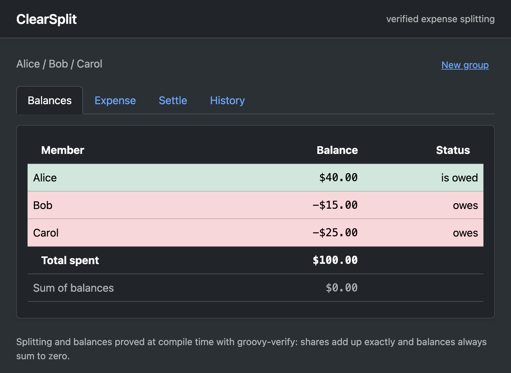
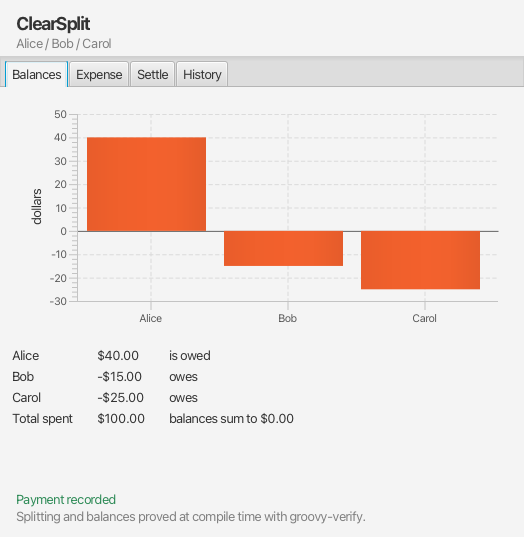
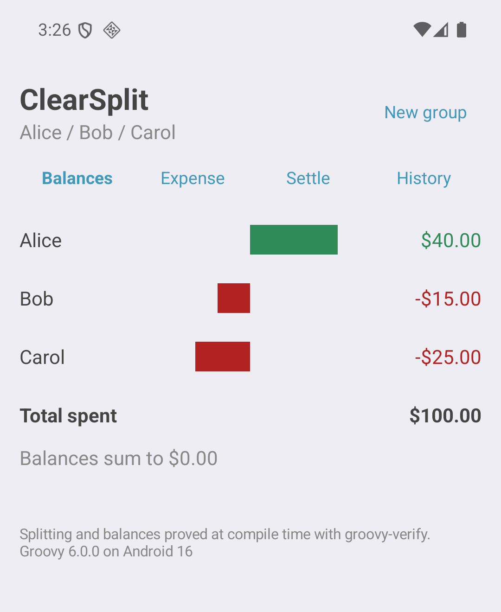
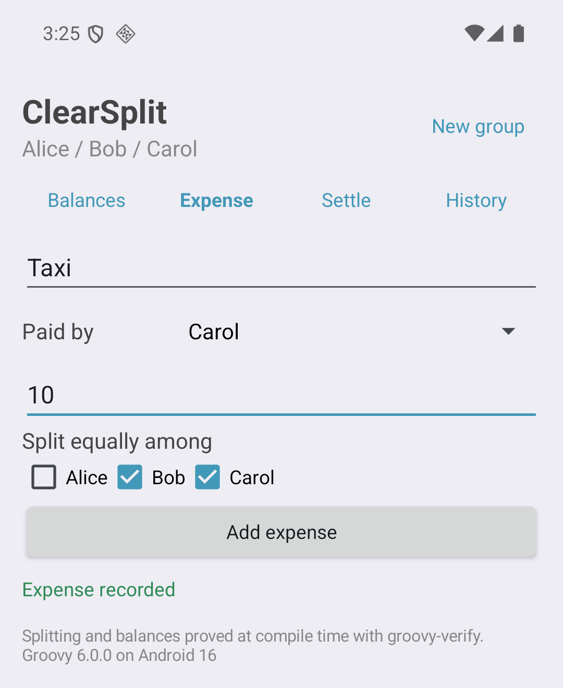

= ClearSplit: one verified core, three Groovy 6 apps
Paul King <paulk-asert|PMC_Member>
:revdate: 2026-10-23T08:00:00+00:00
:keywords: groovy 6, formal methods, verification, groovy-verify, design by contract, dafny, lemmascript, grails, groovyfx, javafx, android
:description: Porting ClearSplit, a verified expense splitter from Dafny and LemmaScript, to Groovy 6: proofs with groovy-verify, then a Grails 9 web app, a GroovyFX desktop app and an Android app over the same verified core.

== Introduction

Splitting the bill after a group dinner sounds like the easiest program in
the world. Add up who paid, divide by who ate, done. Until the total is $10
and there are three of you, and somebody's app quietly loses a cent. Or gives
it to the friend who stayed home.

https://github.com/metareflection/dafny-replay/tree/main/clear-split[ClearSplit]
is a small expense splitter written in Dafny to show that this kind of code can
be proved correct, not just tested. A group has members; members record
expenses, split among some of them, and settlements, where one member pays
another back. ClearSplit proves the properties you'd want from a money app:
an expense's shares add up to exactly what was paid, each step moves each
balance by exactly the right amount, and however long the history, the
balances always sum to zero. Money is never created or destroyed. There is
also a https://github.com/midspiral/clear-split-lemmascript[LemmaScript
version], where the same ideas are written as annotated TypeScript and
verified.

This post ports ClearSplit to Groovy 6. The proofs use
https://github.com/paulk-asert/groovy-verify[groovy-verify], which turns
ordinary Groovy contracts into compile-time proofs checked by the Z3 SMT
solver (the
https://groovy.apache.org/blog/groovy6-formal-methods[formal methods post]
has the full story). Then, because a verified kernel is more fun when someone
can use it, we put three front ends over the very same core:

* a web app using a *Grails 9* snapshot,
* a desktop app using the proposed *groovy-fx* module,
* and an *Android* app in dynamic Groovy.

Same group, same history, same numbers, three apps.

This is a spike, not a product. Several of the pieces are snapshots or
previews: Grails 9 isn't released, groovy-fx is still a pull request, and
Groovy on Android is a Groovy 6 preview feature. Think of it as a look at
where things are heading.

== The shape of the project

The project is a Gradle multi-project build:

[cols="1,4",options="header"]
|===
|Module |What it holds

|`core`
|The verified kernel, `Split` and `Balances`, plus `Group`, the immutable
model the apps use.

|`web`
|A Grails 9.0.0-SNAPSHOT app (Groovy 6.0.0, Spring Boot 4.1).

|`fx`
|A desktop app using groovy-fx, built from the
https://github.com/apache/groovy/pull/2989[pull request] sources.

|`android`
|An Android app, built the way the
https://groovy.apache.org/blog/groovy-android-tictactoe[tic-tac-toe post]
described.
|===

The kernel works on member indices and amounts in cents, as the LemmaScript
version does. It's statically checked by groovy-verify, so a failed proof is a
compile error. Everything else is ordinary Groovy, and much of the UI code is
dynamic Groovy.

== Splitting a bill, exactly

Let's start with a cautionary tale. groovy-verify's examples include a port
of the program on LemmaScript's front page: an agent's first try at splitting
a total across weights. It floors each share, so `allocate(10, [1, 1, 1])`
returns `[3, 3, 3]` and a cent vanishes. The fix hands the leftover cents
back out, one at a time, and the port proves LemmaScript's postcondition:

[source,groovy]
----
@Ensures({ result.sum() == total })
----

And it's true! But look at what the leftover loop does: it gives the spare
cents to positions 0, 1, 2, and so on, whatever their weights. So
`allocate(1, [0, 1, 1])`, splitting one cent between members 1 and 2,
returns `[1, 0, 0]`. It charges member 0, who wasn't part of the expense at
all. The proof is fine; the specification just doesn't say that.

A proof is only as good as its specification. ClearSplit's version says a lot
more. Here is the Groovy port's `Split.equally`, where `joined[m]` is `1` when
member `m` shares the cost and `0` otherwise:

[source,groovy]
----
@TypeChecked(extensions = 'verification.VerifyChecker')
class Split {
    @Requires({ joined != null && (0..<joined.length).every { joined[it] == 0 || joined[it] == 1 } })
    @Requires({ total >= 0 && joined.sum() > 0 })
    @Ensures({ result.length == joined.length && result.sum() == total })
    @Ensures({ (0..<joined.length).every { joined[it] == 0 ==> result[it] == 0 } })
    @Ensures({ (0..<joined.length).every { joined[it] == 1 ==>
        (result[it] == total.intdiv(joined.sum()) || result[it] == total.intdiv(joined.sum()) + 1) } })
    static int[] equally(int total, int[] joined) {
        ...
    }
}
----

Three promises: the shares add up to the total exactly; anyone who didn't
join pays nothing; and everyone who did pays the floor of an equal share or
one cent more. The `==>` is Groovy 6's implication operator, which reads
nicely in specs. These are stock `groovy.contracts` annotations, so the same
contracts also run as runtime checks wherever the code runs.

The body works out the floored share and how many cents flooring lost, then
leaves the rest to two smaller verified methods:

[source,groovy]
----
static int[] equally(int total, int[] joined) {
    int p = joined.sum()
    int base = total.intdiv(p)
    int left = total - p * base             // the cents lost to flooring
    assert 0 <= left && left < p
    int[] shares = baseShares(base, joined)
    handOut(shares, joined, left)
}
----

`baseShares` gives everyone who joined the floored share, and proves that
nobody else pays anything and the shares add up to `p * base`. `handOut` then
gives the first `left` participants one cent more. Swap in `allocate`'s
leftover loop here and `equally`'s second postcondition fails at compile time:

[source,groovy]
----
@Requires({ shares != null && joined != null && shares.length == joined.length })
@Requires({ (0..<joined.length).every { joined[it] == 0 || joined[it] == 1 } && 0 <= left && left <= joined.sum() })
@Ensures({ result != null && result.length == shares.length && result.sum() == shares.sum() + left })
@Ensures({ (0..<shares.length).every { result[it] == shares[it] || (joined[it] == 1 && result[it] == shares[it] + 1) } })
static int[] handOut(int[] shares, int[] joined, int left) {
    int n = shares.length
    int[] result = new int[n]
    int given = 0
    int r = 0
    int s = 0
    int c = 0
    int k = 0
    @Invariant({ 0 <= k && k <= n && n == shares.length && n == joined.length && result.length == n })
    @Invariant({ r == result[0..<k].sum(0) && s == shares[0..<k].sum(0) && c == joined[0..<k].sum(0) })
    @Invariant({ given == (c < left ? c : left) && r == s + given })
    @Invariant({ (0..<k).every { result[it] == shares[it] || (joined[it] == 1 && result[it] == shares[it] + 1) } })
    @Decreases({ n - k })
    while (k < n) {
        if (given < left && joined[k] == 1) {
            result[k] = shares[k] + 1
            given = given + 1
        } else {
            result[k] = shares[k]
        }
        r = r + result[k]
        s = s + shares[k]
        c = c + joined[k]
        k = k + 1
    }
    return result
}
----

The invariants carry the proof. `r`, `s` and `c` are running totals over the
prefix seen so far (`result[0..<k].sum(0)` is the sum of the first `k`
elements). The key line is `given == (c < left ? c : left)`: after seeing `c`
participants we've handed out a cent to each of them, until the `left` cents
ran out. At the end `c` is the number of participants, which is at least
`left`, so `given == left`, and the shares add up to `shares.sum() + left`.
Back in `equally`, that is `p * base + left`, which is `total`. Z3 does that
arithmetic; we only had to say it.

== Balances that always add up

Balances are in cents too: positive means the group owes you, negative means
you owe the group. `Balances.afterExpense` and `afterSettlement` prove Dafny
ClearSplit's _delta laws_, which say exactly how each step moves each
member's balance:

[source,groovy]
----
@Requires({ bal != null && shares != null && shares.length == bal.length && 0 <= payer && payer < bal.length })
@Ensures({ result != null && result.length == bal.length })
@Ensures({ (0..<bal.length).every { result[it] == bal[it] + (it == payer ? amount : 0) - shares[it] } })
@Ensures({ shares.sum() == amount ==> result.sum() == bal.sum() })
static int[] afterExpense(int[] bal, int payer, int amount, int[] shares) { ... }
----

The payer is owed the amount, everyone owes their share, and when the shares
add up to the amount the total doesn't change.

The headline result is ClearSplit's _conservation theorem_: after any valid
history of expenses and settlements, starting from nothing, the balances sum
to zero. In Groovy, the history comes in as parallel arrays, and each
expense's shares are a row of one flat array (groovy-verify's fragment
doesn't include `int[][]`, but slices of a flat array work well). The
theorem is a fold of the two steps over the history:

[source,groovy]
----
@Requires({ (0..<payer.length).every { flat[off[it]..<off[it] + members].sum(0) == amount[it] } })
// ... plus the bounds and validity preconditions
@Ensures({ result.length == members && result.sum() == 0 })
static int[] of(int members, int[] payer, int[] amount, int[] flat, int[] off, int[] from, int[] to, int[] paid) {
    int[] bal = new int[members]
    int e = 0
    @Invariant({ bal != null && bal.length == members && bal.sum() == 0 })
    // ...
    while (e < payer.length) {
        int[] shares = row(flat, off[e], members)   // proved to sum to flat[off[e]..<off[e] + members]
        bal = afterExpense(bal, payer[e], amount[e], shares)
        e = e + 1
    }
    int t = 0
    @Invariant({ bal != null && bal.length == members && bal.sum() == 0 })
    // ...
    while (t < from.length) {
        bal = afterSettlement(bal, from[t], to[t], paid[t])
        t = t + 1
    }
    return bal
}
----

The one precondition that matters is the first: every expense's shares add
up to its amount. That is exactly what `Split.equally` guarantees, so the two
proofs fit together. Each loop only needs the steps' contracts, not their
bodies, which is what makes a proof built from smaller proofs manageable. On a
laptop, the core module, verification included, compiles in about 45
seconds.

== Does the proof have teeth?

A proof that passes no matter what is worse than no proof, because it gives
false confidence. So for every proof I did what mutation testing does for
tests: break the code, or delete a hypothesis, and check the build fails.
Every proof in the kernel passes. Delete the "shares add up to the amount"
precondition from `Balances.of`, or drop `from != to` for settlements, or hand out one cent too
many in `equally`, or give the spare cents to whoever comes next, as
`allocate` does, and each time the build fails.

The checks earned their keep along the way. An early version of the fold
still verified with its key precondition deleted, which led to a soundness
fix in groovy-verify, and a few other issues the port turned up were fixed
there too. groovy-verify is moving quickly, and this post uses a recent
snapshot of it.

That's the value of a real application as a test case for a verifier, and a
reminder that "it verified" deserves the same scepticism as "the tests pass".

== The unverified glue

Above the kernel sits `Group`, an immutable record holding the member names,
expenses and settlements. It isn't verified, but it's built so the kernel's
preconditions always hold. Like the `Step` function in the Dafny version, it
only lets valid actions in:

[source,groovy]
----
@CompileStatic
record Group(List<String> members, List<Expense> expenses, List<Settlement> settlements) implements Serializable {

    /** An expense split equally among the participants, by the verified {@link Split#equally}. */
    Expense splitEqually(String description, int payer, int amount, Collection<Integer> participants) { ... }

    /** This group with the expense added; an invalid expense is rejected. */
    Group plus(Expense e) {
        if (!(0 <= e.payer() && e.payer() < size())) throw new IllegalArgumentException('The payer must be a member')
        ...
        if (e.shares().sum(0) != e.amount()) throw new IllegalArgumentException('The shares must add up to the amount')
        new Group(members, expenses + e, settlements)
    }

    /** This group with the settlement added; an invalid settlement is rejected. */
    Group plus(Settlement s) { ... }

    /** Everyone's balance, by the verified {@link Balances#of}: they always sum to zero. */
    int[] balances() { ... }
}
----

Since `plus` is Groovy's `+` operator, the apps write `group + expense`. Each
app's job is then small: turn user input into a `Group`, catch the
`IllegalArgumentException` and show its message.

== The web app: Grails 9

Grails 8 runs on Groovy 5, but groovy-verify needs Groovy 6, and so does
everything else in this post. So the web app uses a Grails 9.0.0-SNAPSHOT,
which brings Groovy 6.0.0 and Spring Boot 4.1. Apart from bumping the
version and dropping the database (the group lives in the HTTP session), it's
a standard Grails app from https://start.grails.org[Grails Forge]. The
controller is a few short actions:

[source,groovy]
----
def expense(String description, Integer payer, String amount) {
    attempt('expense') {
        Group group = session.group as Group
        Integer cents = Group.cents(amount)
        if (!cents) throw new IllegalArgumentException('Enter an amount above zero')
        List<Integer> participants = params.list('participant').collect { it as Integer }
        session.group = group + group.splitEqually(description ?: 'Expense', payer ?: 0, cents, participants)
        'Expense recorded'
    }
}

private attempt(String tab, Closure<String> action) {
    try {
        flash.message = action()
        redirect action: 'index', params: [tab: flash.message ? 'balances' : tab]
    } catch (IllegalArgumentException e) {
        flash.error = e.message
        redirect action: 'index', params: [tab: tab]
    }
}
----

The views are GSP with Bootstrap: tabs for the balances, adding an expense,
recording a payment and the history.

The snapshot worked without surprises for this app, which is good news for
anyone keen to try Groovy 6 on Grails.

== The desktop app: groovy-fx

https://github.com/apache/groovy/pull/2989[Pull request #2989]
(https://issues.apache.org/jira/browse/GROOVY-11434[GROOVY-11434]) proposes
bringing GroovyFX into Groovy itself as a `groovy-fx` module. It targets
Groovy 7, but its sources compiled unchanged against Groovy 6.0.0 once one
ASM import was pointed at the package Groovy publishes. The build extracts the
module's sources from the PR branch and compiles them, so the app can use it
today.

The UI is a `SceneGraphBuilder` tree. Here is the Balances tab and part of
the Expense tab:

[source,groovy]
----
tabPane(tabClosingPolicy: 'UNAVAILABLE') {
    tab('Balances') {
        vbox(spacing: 8, padding: 12) {
            barChart(id: 'chart', legendVisible: false, animated: false, prefHeight: 240,
                xAxis: categoryAxis(), yAxis: numberAxis(label: 'dollars')) {
                series('balance')
            }
            gridPane(id: 'table', hgap: 24, vgap: 4)
        }
    }
    tab('Expense') {
        gridPane(hgap: 8, vgap: 10, padding: 16) {
            label('What for', row: 0, column: 0)
            textField(id: 'description', promptText: 'Dinner', row: 0, column: 1, hgrow: 'ALWAYS')
            label('Paid by', row: 1, column: 0)
            choiceBox(id: 'payer', items: names, value: names[0], row: 1, column: 1)
            ...
            flowPane(id: 'participants', hgap: 12, row: 3, column: 1) {
                names.each { checkBox(it, selected: true) }
            }
            button('Add expense', id: 'addExpense', row: 4, column: 1, onAction: {
                def chosen = fx.participants.children.findAll { ((CheckBox) it).selected }.collect { indexOf(((CheckBox) it).text) }
                act('Expense recorded') {
                    group + group.splitEqually(fx.description.text ?: 'Expense', indexOf(fx.payer.value), amountOf(fx.amount.text), chosen)
                }
            })
        }
    }
    ...
}
----

Every `id` becomes a variable on the builder, so the event handlers read
`fx.description.text` and `fx.payer.value` directly.

The app's test runs the real UI headless using the Monocle glass platform.
It types in a group, adds the dinner and taxi expenses, records a payment,
checks the balances, and saves the screenshot used in this post. A desktop
UI tested in CI with no display is a nice thing to have.

== The Android app

The Android app follows the recipe from the
https://groovy.apache.org/blog/groovy-android-tictactoe[tic-tac-toe post]:
a plain Groovy library module compiled against `android.jar`, a stock
Android application module (AGP 9.4, minSdk 26) that depends on it like any
jar, and the `grooid` flavour of the Groovy 6.0.0 runtime. No Groovy-specific
Android plugin is needed.

The screens are built in code in dynamic Groovy, with `tap` and closures
doing the work:

[source,groovy]
----
new Button(this).tap {
    text = 'Add expense'
    setOnClickListener {
        def chosen = (0..<boxes.size()).findAll { boxes[it].checked }
        act('Expense recorded') {
            group + group.splitEqually(description.text.toString().trim() ?: 'Expense',
                payer.selectedItemPosition, amountOf(amount), chosen)
        }
    }
}
----

The group is saved after every change as a few lines of text: the members,
then one line per expense or settlement. On launch the app replays them
through `Group`, so a saved group goes through the same validation as one
typed in by hand.

The verified kernel ran on Android unchanged, but the contracts didn't, at
first. The app crashed on its first contract check:

----
java.lang.NoClassDefFoundError: Failed resolution of: Ljava/lang/management/ManagementFactory;
    at org.apache.groovy.contracts.generation.Configurator.initAssertionConfiguration(Configurator.java:76)
----

groovy-contracts' runtime reads the JVM's `-ea` and `-da` flags through
`java.lang.management`, to support turning contract checks on and off per
package. Android has no `java.lang.management`. For this spike, a small
module supplies a stub that reports no flags, which leaves contracts on,
their default. It's the same trick as the existing `SwitchPoint` shim, and
equally temporary: the real fix is for groovy-contracts to fall back to its
default when the management API isn't there. After that, preconditions are
checked on the phone just as on the JVM.

The R8-shrunk release APK comes in at about 1.1 MB, and both it and the debug
build were exercised on an API 36 emulator for this post.

== What wasn't ported

The Dafny original has more than this spike covers:

* Dafny ClearSplit keys members by name in maps. This port follows the
  LemmaScript version and uses indices.
* The lemma that each member's history explains their balance
  (`ExplainSumsToBalance`) is tested here, not proved.
* The collaboration modules, for groups shared between several users, aren't
  ported.

== What we learned

A few practical lessons for anyone proving things with groovy-verify:

* *Specify what you mean.* `allocate` and `equally` both "split money
  correctly", but only one of them says who pays.
* *Check the proof has teeth.* Breaking the code on purpose is cheap, and it
  catches vacuous proofs, whether the spec or the verifier is at fault.
* *Help the solver with ghost totals.* Running totals like
  `t == shares[0..<i].sum(0)` in loop invariants, and the odd intermediate
  `assert`, turned solver timeouts into quick proofs. A longer
  solver timeout didn't help; restructuring the code did.
* *Stay inside the fragment.* Flat arrays with offsets instead of `int[][]`.
* *Build proofs from smaller proofs.* Splitting `equally` into two
  contracted helpers, and writing conservation as a fold over the steps,
  keeps each proof small and the code close to the Dafny version.

And for Groovy itself: Grails 9 on Groovy 6 worked well for this app,
groovy-fx is already usable on Groovy 6, and Groovy on Android has one more
rough edge to file, in groovy-contracts.

== Further information

* https://github.com/paulk-asert/clearsplit-groovy[Source code for this post]
* https://github.com/metareflection/dafny-replay/tree/main/clear-split[ClearSplit in Dafny]
* https://github.com/midspiral/clear-split-lemmascript[ClearSplit in LemmaScript]
* https://github.com/paulk-asert/groovy-verify[groovy-verify]
* https://groovy.apache.org/blog/groovy6-formal-methods[Groovy 6 features for formal method advocates]
* https://github.com/apache/groovy/pull/2989[The groovy-fx pull request]
* https://groovy.apache.org/blog/groovy-android-tictactoe[Playing with Groovy and Android]

== Conclusion

ClearSplit is a small app with real correctness requirements: nobody wants a
money app that loses a cent. In Groovy 6, the kernel's specifications are
ordinary Groovy annotations, groovy-verify proves them at compile time, and
the same contracts double as runtime checks. Over that one verified core sit
a Grails web app, a GroovyFX desktop app and an Android app, all on Groovy
6.0.0. Several pieces are previews, but they show where things are heading,
and it's a nice place to be heading.

.Update history
****
*23/Oct/2026*: Initial version
****
