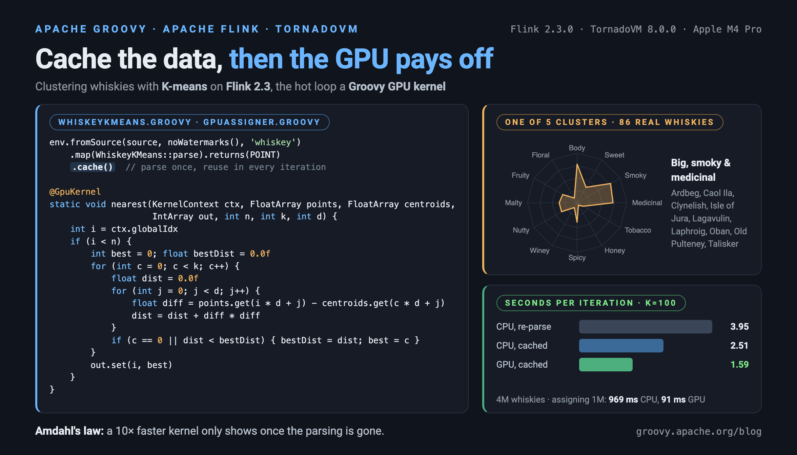

= Whiskey Clustering with Groovy&reg; and Apache Flink&reg;
Paul King <paulk-asert|PMC_Member>
:revdate: 2026-10-31T12:00:00+00:00
:keywords: groovy, flink, flink ml, kmeans, clustering, whisky, whiskey, tornadovm, gpu
:description: We cluster Scotch whiskies with Apache Flink and Groovy: with Flink ML, by hand on Flink 2.3, and with the hot loop on the GPU via TornadoVM.

== Introduction

image:https://www.apache.org/logos/res/flink/default.png[Flink logo,150,float="right"]
In our ongoing series of data science posts clustering 86 Scotch whiskies by their flavour profiles,
we have looked at how Groovy scales up with distributed data processing frameworks like
link:using-groovy-with-apache-wayang.html[Apache Spark and Apache Wayang] and
link:whiskey-clustering-with-groovy-and.html[Apache Ignite].
This time we look at another heavyweight of the Apache ecosystem:
https://flink.apache.org/[Apache Flink].

Flink is best known for stateful computations over unbounded streams of data,
but it is equally at home with bounded data sets.
Groovy compiles to JVM bytecode, so we can use Flink's Java APIs directly,
and Groovy keeps the pipeline code short.

We'll take three passes at the problem:

* using the K-means implementation from Flink's machine learning library, Flink ML (see caveats below)
* writing K-means ourselves on the current Flink 2.3 DataStream API
* moving the expensive part of each K-means iteration onto the GPU with
  https://www.tornadovm.org[TornadoVM], following on from our
  link:groovy-tornadovm.html[earlier post] on running Groovy on the GPU

Along the way we'll hit a Flink bug, a caching trap, a couple of Groovy compiler issues, and
Amdahl's law.

== Whiskey Clustering

A quick reminder of the problem. The whiskies produced by
https://www.niss.org/sites/default/files/ScotchWhisky01.txt[86 distilleries] have been
ranked by expert tasters on 12 criteria (Body, Sweetness, Smoky, Medicinal, Tobacco, Honey,
Spicy, Winey, Nutty, Malty, Fruity and Floral), each scored from 0 to 4:

----
RowID,Distillery,Body,Sweetness,Smoky,Medicinal,Tobacco,Honey,Spicy,Winey,Nutty,Malty,Fruity,Floral
01,Aberfeldy,2,2,2,0,0,2,1,2,2,2,2,2
02,Aberlour,3,3,1,0,0,4,3,2,2,3,3,2
03,AnCnoc,1,3,2,0,0,2,0,0,2,2,3,2
04,Ardbeg,4,1,4,4,0,0,2,0,1,2,1,0
...
----

K-means groups whiskies with similar characteristics into clusters. If we have a favourite
whisky, chances are we'll like others in the same cluster. If we feel like a change, we can try one
from another cluster. Each cluster's _centroid_ is the notional point in the middle of the cluster:
the average score of its members for each criterion.

The algorithm is simple. Start with _k_ guesses for the centroids, then repeat two steps:
_assign_ every whisky to its nearest centroid, and _update_ each centroid to the average
of the whiskies assigned to it. Stop when the centroids stop moving.

== Using Flink ML

Flink ML provides a distributed K-means, so let's start there. Flink ML works with Flink's
Table API: we read the CSV file as a stream, turn each row into a distillery name plus a
`DenseVector` of features, and hand the resulting table to the estimator:

[source,groovy]
----
var file = WhiskeyFlink.classLoader.getResource('whiskey.csv').file
var eEnv = StreamExecutionEnvironment.executionEnvironment
var tEnv = StreamTableEnvironment.create(eEnv)

var source = FileSource.forRecordStreamFormat(new TextLineInputFormat(), new Path(file)).build()
var stream = eEnv
    .fromSource(source, WatermarkStrategy.noWatermarks(), 'csvfile')
    .filter(line -> !line.startsWith('RowID'))
    .map(line -> {
        var cols = line.split(',')
        Row.of(cols[1], Vectors.dense(cols[2..-1] as double[]))
    }).returns(new RowTypeInfo(Types.STRING, DenseVectorTypeInfo.INSTANCE))

var inputTable = tEnv.fromDataStream(stream).as('distillery', 'features')
var kmeans = new KMeans(k: 5, seed: 1L)
var kmeansModel = kmeans.fit(inputTable)
----

Groovy's named-argument constructor lets us set the estimator's parameters
(`k`, `seed`) in one line. Converting the feature columns to doubles is just
`cols[2..-1] as double[]`.

The model's `transform` method adds a `prediction` column to the table. We collect the result,
group the rows by cluster, and print each cluster's centroid and members:

[source,groovy]
----
var outputTable = kmeansModel.transform(inputTable)[0]
var clusters = outputTable.execute().collect().toList()
    .groupBy { Row row -> row.getField(kmeans.predictionCol) as int }
    .sort { it.key }

println 'Centroids:'
clusters.each { k, rows ->
    var features = rows.collect { (DenseVector) it.getField('features') }
    var centroid = (0..<features[0].size()).collect { int j -> (features.sum { it.get(j) } as double) / features.size() }
    println "Cluster $k: ${centroid.collect { sprintf '%.2f', it }.join(', ')}"
}
clusters.each { k, rows ->
    println "Cluster $k (${rows.size()} members): ${rows*.getField('distillery').sort().join(', ')}"
}
----

Why calculate the centroids from the members, when the model holds them already?
Flink's Table API is lazy. Reading the model data with `kmeansModel.modelData` and
then calling `transform` runs two separate jobs, and _each one trains the model again_. Within
each job the result is consistent, but the cluster numbers in one job needn't match the other.
Working from a single `transform` result avoids the problem.

Here is the output (minus Flink's logging):

----
Centroids:
Cluster 0: 3.67, 1.50, 3.67, 3.33, 0.67, 0.17, 1.67, 0.50, 1.17, 1.33, 1.17, 0.17
Cluster 1: 1.76, 2.52, 1.24, 0.24, 0.14, 1.24, 1.62, 0.76, 0.48, 1.81, 1.67, 1.90
Cluster 2: 1.36, 2.32, 1.00, 0.27, 0.00, 0.91, 0.77, 0.36, 1.64, 1.73, 2.09, 2.18
Cluster 3: 2.68, 2.48, 1.48, 0.04, 0.04, 1.84, 1.68, 1.92, 2.04, 2.00, 2.12, 1.76
Cluster 4: 1.83, 1.83, 2.08, 1.25, 0.17, 1.17, 1.33, 0.75, 1.83, 1.75, 1.17, 1.08
Cluster 0 (6 members): Ardbeg, Caol Ila, Clynelish, Lagavulin, Laphroig, Talisker
Cluster 1 (21 members): ArranIsleOf, Belvenie, Benriach, Bladnoch, Dalwhinnie, Deanston, GlenDeveronMacduff, GlenElgin, GlenGarioch, GlenOrd, GlenSpey, Glenkinchie, Glenlossie, Inchgower, Linkwood, RoyalBrackla, Speyburn, Teaninich, Tomatin, Tomintoul, Tullibardine
Cluster 2 (22 members): AnCnoc, Auchentoshan, Aultmore, Bunnahabhain, Cardhu, Craigganmore, Dufftown, GlenGrant, GlenMoray, Glenallachie, Glenfiddich, Glengoyne, Glenmorangie, Loch Lomond, Mannochmore, Miltonduff, Scapa, Speyside, Strathmill, Tamdhu, Tamnavulin, Tobermory
Cluster 3 (25 members): Aberfeldy, Aberlour, Auchroisk, Balmenach, BenNevis, Benrinnes, Benromach, BlairAthol, Craigallechie, Dailuaine, Dalmore, Edradour, GlenKeith, Glendronach, Glendullan, Glenfarclas, Glenlivet, Glenrothes, Glenturret, Knochando, Longmorn, Macallan, Mortlach, RoyalLochnagar, Strathisla
Cluster 4 (12 members): Ardmore, Balblair, Bowmore, Bruichladdich, GlenScotia, Highland Park, Isle of Jura, Oban, OldFettercairn, OldPulteney, Springbank, Tomore
----

Cluster 0 is the big, smoky, medicinal Islay style. Cluster 3 holds the rich, sherried
(Winey) Speyside malts such as Macallan, Glenfarclas and Mortlach. Even with a fixed seed, the
clusters vary a little from run to run, because the order in which Flink's parallel
tasks see the data varies.

One caveat. Flink ML's last release, 2.3.0, came out in mid-2023 and supports Flink up to 1.17.
The example above runs on Flink 1.18.1. Flink itself has moved on to 2.3, and Flink 2.0
removed APIs that Flink ML depends on, including the DataSet API. So for current Flink,
we'll write K-means ourselves.

== K-means by hand on Flink 2.3

Older Flink K-means examples used the DataSet API and its built-in bulk iterations.
Both are gone in Flink 2. The DataStream API can run in `BATCH` mode over bounded input, so
we make each K-means iteration a separate bounded job. Our Groovy driver holds the current centroids,
runs a job, and reads back the new centroids. It is the same pattern a Spark K-means driver uses.

Each job assigns every profile to its nearest centroid, then sums the
profiles and counts the members of each cluster. The profiles themselves are read and parsed
only once, by the first job, and cached for the rest (more on that below):

[source,groovy]
----
var points = load(env, file)
for (iteration in 1..maxIterations) {
    var updated = assign(points, centroids, assigner)
        .map(t -> Tuple3.of(t.f0, t.f2, 1)).returns(SUM)
        .keyBy(t -> t.f0, Types.INT)
        .reduce((a, b) -> Tuple3.of(a.f0, plus(a.f1, b.f1), a.f2 + b.f2)).returns(SUM)
        .executeAndCollect(k)
    float[][] next = centroids.collect { float[] c -> c.clone() } as float[][]
    updated.each { next[it.f0] = it.f1.collect { float v -> v / it.f2 } as float[] }
    boolean converged = (0..<k).every { int c -> distance(next[c], centroids[c]) < 1e-3d }
    centroids = next
    if (converged) {
        println "Converged after $iteration iterations"
        break
    }
}
----

`SUM` is the type of a `(cluster, sum of profiles, count)` tuple. Flink inspects
functions to work out the types flowing between operators, but generic types are erased
at runtime, so for tuples we tell it with `returns`, much as we would with Java lambdas.
Flink couldn't infer the key type of the Groovy lambda passed to `keyBy` either, so we pass `Types.INT`.

The `load` method reads the CSV file into a stream of `(distillery, profile)` tuples and caches it,
and `assign` adds the assignment step:

[source,groovy]
----
static DataStream<Tuple2<String, float[]>> load(StreamExecutionEnvironment env, String file) {
    var source = FileSource.forRecordStreamFormat(new TextLineInputFormat(), new Path(file)).build()
    env.fromSource(source, WatermarkStrategy.noWatermarks(), 'whiskey').setParallelism(env.parallelism)
        .filter(line -> !line.startsWith('RowID'))
        .map(WhiskeyKMeans::parse).returns(POINT)
        .cache()
}

static DataStream<Tuple3<Integer, String, float[]>> assign(DataStream<Tuple2<String, float[]>> points,
        float[][] centroids, Assigner assigner) {
    points.transform('assign', ASSIGNED, new AssignOperator(centroids, assigner))
}
----

The assignment step uses a small custom operator. It collects the profiles arriving at
its parallel instance and, once the input ends, assigns the whole batch in one go:

[source,groovy]
----
@CompileStatic
class AssignOperator extends AbstractStreamOperator<Tuple3<Integer, String, float[]>>
        implements OneInputStreamOperator<Tuple2<String, float[]>, Tuple3<Integer, String, float[]>>, BoundedOneInput {
    private final float[][] centroids
    private final Assigner assigner
    private transient List<Tuple2<String, float[]>> batch

    ...

    void processElement(StreamRecord<Tuple2<String, float[]>> element) {
        batch << element.value
    }

    void endInput() {
        if (!batch) return
        List<float[]> points = new ArrayList<>(batch.size())
        for (Tuple2<String, float[]> p : batch) points.add(p.f1)
        int[] clusters = assigner.nearest(points, centroids)
        batch.eachWithIndex { p, i ->
            output.collect(new StreamRecord<>(Tuple3.of(clusters[i], p.f0, p.f1)))
        }
    }
}
----

Working a batch at a time doesn't matter much for the CPU, but it's what a GPU needs, as we'll see shortly.
The CPU `Assigner` is the obvious nested loop:

[source,groovy]
----
static int nearest(float[] point, float[][] centroids) {
    int best = 0
    float bestDist = Float.MAX_VALUE
    for (int c = 0; c < centroids.length; c++) {
        float dist = 0
        for (int j = 0; j < point.length; j++) {
            float diff = point[j] - centroids[c][j]
            dist += diff * diff
        }
        if (dist < bestDist) { bestDist = dist; best = c }
    }
    best
}
----

We start from five whiskies chosen at random (with a fixed seed), and run it on JDK 21:

----
$ ./gradlew :flink:runWhiskeyKMeansCpu
Converged after 8 iterations
Centroids:
Cluster 0: 1.93, 2.33, 1.63, 0.41, 0.11, 1.78, 1.44, 1.11, 1.70, 1.96, 1.37, 1.56
Cluster 1: 2.00, 2.50, 1.21, 0.21, 0.14, 1.14, 1.71, 0.86, 0.29, 1.64, 2.07, 2.14
Cluster 2: 1.40, 2.36, 1.04, 0.24, 0.00, 0.80, 0.88, 0.36, 1.64, 1.76, 2.00, 2.16
Cluster 3: 3.18, 2.45, 1.55, 0.09, 0.00, 1.91, 1.82, 2.64, 2.00, 2.00, 2.45, 1.45
Cluster 4: 3.11, 1.44, 3.11, 2.89, 0.56, 0.22, 1.56, 0.44, 1.44, 1.44, 1.33, 0.44
Cluster 0 (27 members): Aberfeldy, Ardmore, Auchroisk, BenNevis, Benrinnes, Benromach, BlairAthol, Bowmore, Bruichladdich, Craigallechie, Dalwhinnie, Deanston, GlenDeveronMacduff, GlenKeith, GlenScotia, Glenrothes, Glenturret, Highland Park, ...
Cluster 1 (14 members): ArranIsleOf, Belvenie, Benriach, Bladnoch, GlenElgin, GlenGarioch, GlenOrd, Glenkinchie, Glenlivet, Linkwood, RoyalBrackla, Speyburn, Teaninich, Tullibardine
Cluster 2 (25 members): AnCnoc, Auchentoshan, Aultmore, Balblair, Bunnahabhain, Cardhu, Craigganmore, Dufftown, GlenGrant, GlenMoray, GlenSpey, Glenallachie, Glenfiddich, Glengoyne, Glenlossie, Glenmorangie, Loch Lomond, Longmorn, Mannochmore, ...
Cluster 3 (11 members): Aberlour, Balmenach, Dailuaine, Dalmore, Glendronach, Glendullan, Glenfarclas, Macallan, Mortlach, RoyalLochnagar, Strathisla
Cluster 4 (9 members): Ardbeg, Caol Ila, Clynelish, Isle of Jura, Lagavulin, Laphroig, Oban, OldPulteney, Talisker
----

Again we see a peaty cluster (4) and a sherried one (3).

=== Why not `mapPartition`?

Flink 1.20 added `fullWindowPartition().mapPartition(...)` to the DataStream API, which
seemed exactly right for batching the assignment step. With it, our jobs failed with
`IllegalArgumentException: Cannot append empty data`, returned corrupted values, or hung.
A plain Java version with eight integers did the same on Flink 1.20 and every 2.x release we tried, so
it isn't a Groovy problem. The cause is in `MapPartitionOperator`, which calls the user function on a
separate `TaskUDFExecutor` thread. Records it emits are written to the network output from that thread.
Meanwhile the task's own thread forwards the end-of-input watermark to the same output, and when the two
overlap, the output buffers are corrupted. Only functions that emit while still reading their input,
as our assignment step did, are affected. A function that reads everything before emitting
anything, such as one summing a partition, finishes after the watermark has gone, which may be why
the problem hasn't been noticed. We reported it as
link:https://issues.apache.org/jira/browse/FLINK-41296[FLINK-41296].

The custom operator above does all its work on the task thread, in `processElement` and `endInput`,
so only one thread ever writes to its output. It is also a bit more general: we decide how a batch is processed.

=== Caching between jobs

Every iteration needs the same parsed profiles. Without help, each job would re-read and re-parse the file.
Flink's answer for batch jobs is `DataStream.cache()`: the first job that uses a cached stream
keeps its result on the cluster, and later jobs read that instead of recomputing it.

Our first attempt cached the stream but still re-parsed every row in every iteration, and was
slower for it. A counter in the parsing step showed what was happening. A cached result only lives as long as the cluster it was
written on, and when a program runs locally, each `execute` starts a fresh mini cluster for that one job. So every
iteration wrote a new cache, which nothing ever read. Flink falls back to recomputing a missing cache, so nothing fails.
On a real deployment the iterations would be submitted to a long-running session cluster.
Locally we do the equivalent: start one `MiniCluster` and point the environment at it:

[source,groovy]
----
try (var miniCluster = new MiniCluster(new MiniClusterConfiguration.Builder().setNumSlotsPerTaskManager(4).build())) {
    miniCluster.start()
    var uri = miniCluster.restAddress.get()
    var env = StreamExecutionEnvironment.createRemoteEnvironment(uri.host, uri.port)
    env.runtimeMode = RuntimeExecutionMode.BATCH
    env.parallelism = 4
    var points = load(env, file)
    // the iterations, as above
}
----

With that change, the profiles are parsed once, in the first iteration. There was one more catch.
For our small file, Flink infers a parallelism of 1 for the source, so the cache is written as a single
partition, and the next job, running at parallelism 4, fails with `ClusterDatasetCorruptedException`.
That is why `load` sets the source's parallelism explicitly.

== Onto the GPU

Most of the arithmetic in K-means is in the assignment step: for each of _n_ points, _k_ distances
over _d_ dimensions. Each point is independent of the others, which is ideal for a GPU.

=== Flink and TornadoVM: earlier work

Running Flink operators on GPUs has been tried before. In
https://www.vldb.org/pvldb/vol15/p3869-xekalaki.pdf[_Enabling Transparent Acceleration of Big Data Frameworks Using Heterogeneous Hardware_]
(PVLDB 15(13), 2022), the TornadoVM team integrated TornadoVM into Flink so that
_unmodified_ Flink programs could run their map and reduce functions on GPUs and FPGAs.
Their https://github.com/mairooni/Flink-TornadoVM-Artifact[artifact] is a patched Flink 1.11.1:
around twenty runtime classes, such as `MapDriver`, `ReduceDriver` and `JobGraphGenerator`, are modified.
At job submission it reads the bytecode of the user's DataSet `MapFunction` and `ReduceFunction` classes,
generates a "skeleton" class from them, and compiles that with a fork of TornadoVM containing
Flink-specific hooks. K-means was one of their benchmarks.

That design depends on things which no longer exist: the DataSet API, JDK 8 with JVMCI, and
TornadoVM's old Graal-based compiler, which TornadoVM 8.0.0 replaced with its own compiler, TC.
Bringing it forward would mean rewriting it rather than upgrading it.
Instead, we do the integration explicitly: our Flink operator hands each batch to a TornadoVM kernel.
It is less transparent, but works with stock Flink 2.3 and TornadoVM 8.0.0, today.

=== The kernel

As in the link:groovy-tornadovm.html[earlier post], we write the kernel with TornadoVM's `KernelContext`
API, statically compiled, using the small `@GpuKernel` AST transformation from that post. It keeps
float arithmetic in float, rather than Groovy's default of widening it to double, which Apple GPUs don't support.
Each GPU thread handles one point:

[source,groovy]
----
@GpuKernel
static void nearest(KernelContext ctx, FloatArray points, FloatArray centroids, IntArray out, int n, int k, int d) {
    int i = ctx.globalIdx
    if (i < n) {
        int best = 0
        float bestDist = 0.0f
        for (int c = 0; c < k; c++) {
            float dist = 0.0f
            for (int j = 0; j < d; j++) {
                float diff = points.get(i * d + j) - centroids.get(c * d + j)
                dist = dist + diff * diff
            }
            if (c == 0 || dist < bestDist) {
                bestDist = dist
                best = c
            }
        }
        out.set(i, best)
    }
}
----

There are two small differences from the CPU version. `@GpuKernel` doesn't handle compound assignments
like `+=`, so we write `dist = dist + diff * diff`. And we avoid `Float.MAX_VALUE`, a field
of another class, by treating the first centroid specially.

The GPU `Assigner` copies the batch into TornadoVM's off-heap arrays and runs the kernel.
Every K-means iteration is a new Flink job, with new operator instances, so building a new
`TaskGraph` each time would recompile the kernel every iteration. Instead we keep each compiled execution plan,
along with its buffers, in a static pool, and reuse it in later jobs that run in the same JVM:

[source,groovy]
----
Plan(int n, int k, int d) {
    ...
    var name = "assign${COUNT.incrementAndGet()}"
    var graph = new TaskGraph(name)
        .transferToDevice(EVERY_EXECUTION, points, centroids)
        .task('nearest', GpuAssigner::nearest, new KernelContext(), points, centroids, assigned, n, k, d)
        .transferToHost(EVERY_EXECUTION, assigned)
    executionPlan = new TornadoExecutionPlan(graph.snapshot())
        .withGridScheduler(new GridScheduler("${name}.nearest".toString(), new WorkerGrid1D(n)))
}

int[] run(List<float[]> pts, float[][] cs) {
    for (int i = 0; i < n; i++) for (int j = 0; j < d; j++) points.set(i * d + j, pts[i][j])
    for (int c = 0; c < k; c++) for (int j = 0; j < d; j++) centroids.set(c * d + j, cs[c][j])
    executionPlan.execute()
    assigned.toHeapArray()
}
----

We run the same Flink job through TornadoVM's `tornado` launcher, which puts TornadoVM on the module path.
Flink runs as a local mini cluster in the same JVM, so its tasks can use the GPU directly:

----
$ ./gradlew :flink:runWhiskeyKMeansGpu -PtornadoFlags=--threadInfo
Task info: assign1.nearest
	Backend           : METAL
	Device            : Apple M4 Pro METAL_DEVICE_TYPE_GPU (available)
	Dims              : 1
	Global work size  : [86, 1, 1]
...
Converged after 8 iterations
Centroids:
Cluster 0: 1.93, 2.33, 1.63, 0.41, 0.11, 1.78, 1.44, 1.11, 1.70, 1.96, 1.37, 1.56
...
----

The centroids and clusters are identical to the CPU run's. The same happens with TornadoVM's
OpenCL backend. Here is part of the Metal code TornadoVM generated from the Groovy kernel:

[source,c]
----
  i = (int) _thread_position_in_grid.x;
  if (i >= 86) {
    v3 = 0;
  } else {
    v3 = 1;
  }
  if (v3 != 0) {
    ...
      for (;;) {
        ...
        diff = points_data[(int) ((uint) i_off + (uint) j)] - centroids_data[(int) ((uint) c_off + (uint) j)];
        dist = dist + diff * diff;
        j = (int) ((uint) j + (uint) 1);
      }
----

The float arithmetic stays float. TornadoVM has specialised the kernel for this batch, so
`n` is the constant `86`. The `v3 = 0`/`v3 = 1` flags come from Groovy compiling comparisons to
a `0`/`1` value; link:https://issues.apache.org/jira/browse/GROOVY-12542[GROOVY-12542], mentioned
in the earlier post, makes this more javac-like in the upcoming Groovy 6.0.1.

== Scaling up

86 whiskies are about 3KB of data, which is far too little for the GPU to make a difference.
To get something bigger, a generator writes 4 million synthetic profiles: each is one of the real
86 with Gaussian noise added, as if a few more tasters had a go. They go into four files, so each of
Flink's four source tasks reads one. We timed the assignment step for each million-row batch,
and each iteration of the whole job, for different numbers of clusters, with and without caching
(the `nocache` option re-reads the data every iteration):

----
$ ./gradlew :flink:generateWhiskies
$ ./gradlew :flink:runWhiskeyKMeansCpu -Pdata=build/whiskies -Ptiming -Pk=50 -Piterations=4
$ ./gradlew :flink:runWhiskeyKMeansGpu -Pdata=build/whiskies -Ptiming -Pk=50 -Piterations=4
$ ./gradlew :flink:runWhiskeyKMeansCpu -Pdata=build/whiskies -Ptiming -Pk=50 -Piterations=4 -Pnocache
----

[cols="1,2,2,3,3",options="header"]
|===
| k | Assign 1M points, CPU | Assign 1M points, GPU | Iteration, CPU (no cache / cached) | Iteration, GPU (no cache / cached)
| 5 | 95 ms | 64 ms | 2.95 s / 1.68 s | 2.95 s / 1.58 s
| 20 | 285 ms | 108 ms | 3.33 s / 1.87 s | 3.29 s / 1.71 s
| 50 | 552 ms | 120 ms | 3.53 s / 2.09 s | 3.03 s / 1.75 s
| 100 | 969 ms | 91 ms | 3.95 s / 2.51 s | 3.09 s / 1.59 s
|===

These are medians over three iterations, on an Apple M4 Pro, excluding the first iteration
(which includes JIT and kernel compilation, and with caching, parsing the data), so treat them as indicative.
The CPU assignment time grows with _k_, as expected. On the GPU, the kernel itself takes only
about 5 ms for a million points with _k_ = 5. Most of the GPU column is copying the batch into
TornadoVM's arrays, which doesn't depend on _k_, and the four Flink tasks sharing one GPU.

The iteration times tell the other half of the story. This is Amdahl's law: speeding up one part of a job
only helps as much as that part contributes. Without caching, every iteration re-reads and parses
320MB of CSV, which costs about 1.4 seconds whatever else we do. On top of that sit the rest of the job and the
assignment step. With 5 or 20 clusters the GPU saves nothing worth measuring; with 100 it saves about 0.9 seconds of 4.

Caching removes the parsing from every iteration after the first. Now the assignment step is a much bigger share of
what remains, and the GPU makes a clear difference: at _k_ = 100 an iteration takes 2.5 seconds on the CPU and 1.6 on the GPU.
The GPU iteration time hardly changes with _k_. What is left, about 1.6 seconds, is reading the cached records back,
serialising them between operators, copying them into TornadoVM's arrays, and shuffling the partial sums.
That is now the part to work on, for example by keeping the profiles in a form the GPU can use directly.

== Groovy notes

Statically compiled Groovy worked well with both Flink and TornadoVM, but we did find two compiler issues:

* *Cloning arrays.* Under `@CompileStatic`, `a[0].clone()` on a `float[][]`, or `it.clone()` in a closure
  over one, compiles to a call of `Object.clone()` on a reference the JVM verifier only knows is an
  `Object`, and fails with `VerifyError: Bad access to protected data`
  (link:https://issues.apache.org/jira/browse/GROOVY-12595[GROOVY-12595]). Declaring the closure parameter's type,
  `{ float[] c -> c.clone() }`, avoids it.
* *Spread-dot over large lists.* We first wrote `batch*.f1` in `AssignOperator`. That took around
  400 ms per million points, more than the assignment itself. Groovy compiles the spread into a loop which keeps
  the result list on the JVM's operand stack, and HotSpot can't compile a loop like that while it is running
  (`COMPILE SKIPPED: OSR starts with non-empty stack`). In a method that runs once over a big list, the loop stays in
  the interpreter. A plain loop was around ten times faster
  (link:https://issues.apache.org/jira/browse/GROOVY-12642[GROOVY-12642]).

Both are present in Groovy 6.0.0 and current snapshots. Like GROOVY-12542, the second is a case where
bytecode closer to javac's would make a real difference.

== Conclusion

Groovy makes a pleasant language for Flink jobs, whether through Flink ML's high-level
estimators or the DataStream API. Flink ML is a quick way to cluster our whiskies, but it is
tied to Flink 1.x. Writing K-means by hand on Flink 2.3 takes a little more code, and a custom
operator gives us batches to send to a GPU. With TornadoVM 8.0.0 and the `@GpuKernel`
transformation, the assignment step runs as a Groovy kernel on an Apple GPU, unchanged on Metal and OpenCL,
with results identical to the CPU version.

For our 86 whiskies, the GPU makes no difference. At four million, it is many times faster at the arithmetic, but
end-to-end speed depends on everything else the job does. Caching the parsed data lets more of that
speed show, but moving data, not computing on it, still limits jobs like this one.

== Further information

* https://flink.apache.org/[Apache Flink] and https://nightlies.apache.org/flink/flink-ml-docs-stable/[Flink ML]
* https://github.com/paulk-asert/groovy-data-science/tree/master/subprojects/WhiskeyFlink[WhiskeyFlink]: the Flink ML example
* https://github.com/paulk-asert/groovy-tornadovm/tree/main/flink[groovy-tornadovm/flink]: the Flink 2.3 K-means, with CPU and GPU assignment
* link:groovy-tornadovm.html[Running Groovy on the GPU with TornadoVM], including `@GpuKernel`
* https://www.vldb.org/pvldb/vol15/p3869-xekalaki.pdf[Enabling Transparent Acceleration of Big Data Frameworks Using Heterogeneous Hardware]
  and its https://github.com/mairooni/Flink-TornadoVM-Artifact[artifact]
* Earlier whisky posts: link:using-groovy-with-apache-wayang.html[Apache Wayang and Apache Spark],
  link:whiskey-clustering-with-groovy-and.html[Apache Ignite] and link:whisky-revisited.html[Whisky flavor profiles revisited]
