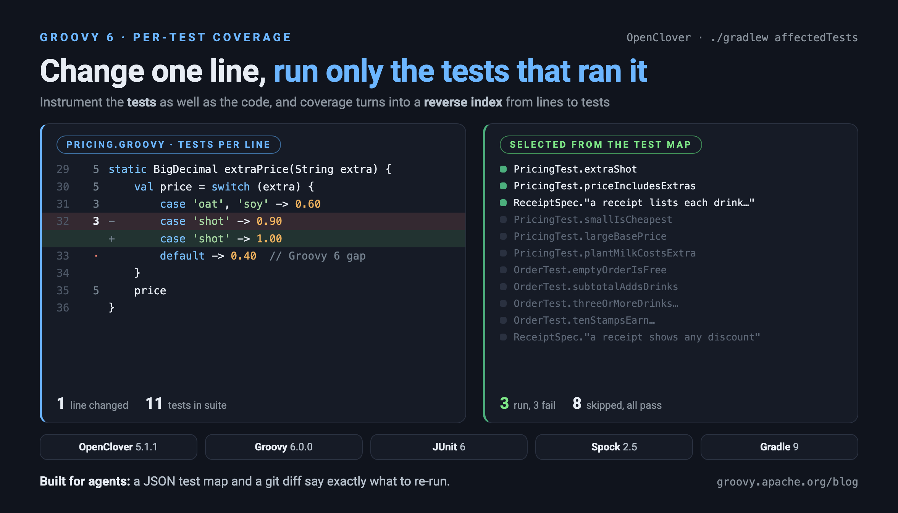
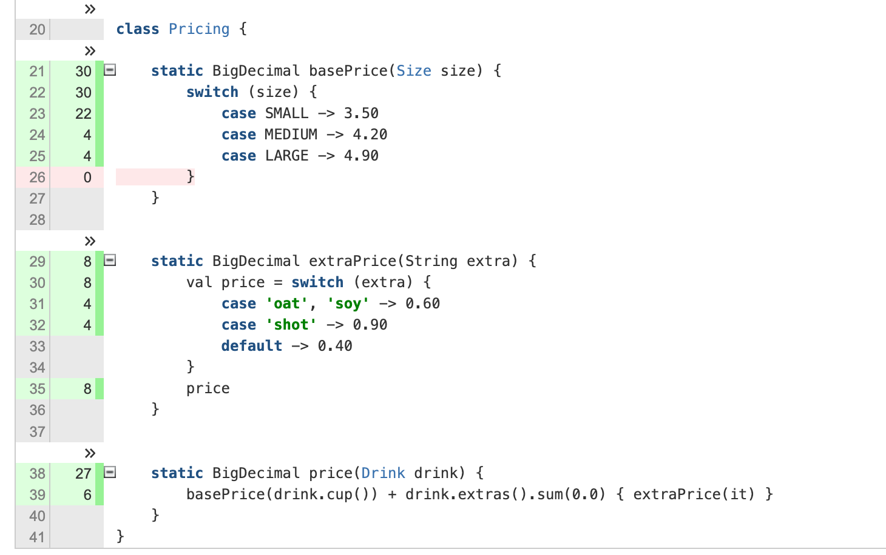

= Which tests should I run? Per-test coverage for Groovy 6 with OpenClover
Paul King <paulk-asert|PMC_Member>
:revdate: 2026-10-20T08:00:00+00:00
:keywords: groovy, openclover, code coverage, per-test coverage, test optimization, test selection, ai agents, spock, junit, gradle
:description: Using OpenClover with Groovy 6: what per-test coverage gives you, & turning it into a line-to-tests map that tells an AI agent exactly which tests to run.

== Introduction

> [blue]#Most coverage tools answer "which lines did my tests run?". OpenClover can also answer the reverse question: "which tests ran this line?". In this post we check whether OpenClover works with Groovy 6, look at its per-test coverage and test optimization features, and turn its coverage database into a small tool that tells an AI coding agent exactly which tests to re-run after it changes a line.#

https://openclover.org[OpenClover] is the open source
continuation of Atlassian's Clover code coverage tool. Unlike
tools such as JaCoCo, which run as a Java agent (`-javaagent`) and instrument
bytecode as classes are loaded, OpenClover instruments _source_, and for Groovy it does
this with an AST transformation hooked into the compiler.

One long-standing Clover feature is easy to overlook: it instruments
the *tests* as well as the code under test. Each test method records
when it starts and stops, so every coverage hit can be attributed
to the test that caused it. The result is *per-test coverage*, and
once you have it you can invert it: for any line of production code,
the exact set of tests that executed it.

That inverted view is useful to humans (OpenClover's HTML report
shows it and it powers Clover's _test optimization_ feature), but it
is arguably even more useful to AI coding agents. An agent that has
just changed one line of a large code base faces a choice: run the
whole suite (slow), run the tests it _guesses_ are related (risky), or
ask a tool that _knows_. We'll build that tool.

OpenClover 5.0 added support for Groovy 3 through 5. The current release
is 5.1.1. Groovy 6 isn't listed, so the first question is whether it works anyway.

The example code is in the
https://github.com/paulk-asert/groovy-openclover[groovy-openclover]
companion repo.

== The example

We'll use a small coffee-shop pricing domain. A `Drink` has a cup size
and some extras; `Pricing` works out what each costs, `Order` totals a
list of drinks and applies discounts, and `Receipt` formats the result.
It uses a few Groovy 6 features along the way: `val` declarations,
map-style destructuring, and switch expressions.

[source,groovy]
----
class Pricing {
    static BigDecimal basePrice(Size size) {
        switch (size) {
            case SMALL -> 3.50
            case MEDIUM -> 4.20
            case LARGE -> 4.90
        }
    }

    static BigDecimal extraPrice(String extra) {
        val price = switch (extra) {
            case 'oat', 'soy' -> 0.60
            case 'shot' -> 0.90
            default -> 0.40
        }
        price
    }

    static BigDecimal price(Drink drink) {
        basePrice(drink.cup()) + drink.extras().sum(0.0) { extraPrice(it) }
    }
}
----

`Receipt` destructures each record by property name:

[source,groovy]
----
class Receipt {
    static String render(Order order) {
        val lines = order.drinks.collect { drink ->
            def (name: n, cup: c, extras: xs) = drink
            val label = xs ? "$n (${xs.join(', ')})" : n
            "${c.name()[0]} $label".padRight(28) + Pricing.price(drink)
        }
        val discount = order.discount()
        if (discount) {
            lines << 'Discount'.padRight(28) + "-$discount"
        }
        lines << 'Total'.padRight(28) + order.total()
        lines.join('\n')
    }
}
----

There are 11 tests in total: JUnit 6 tests for `Pricing` and `Order`, and a
Spock 2.5 specification for `Receipt`. That gives us both of the test
frameworks OpenClover hooks into:

[source,groovy]
----
class PricingTest {
    @Test
    void extraShot() {
        assert Pricing.extraPrice('shot') == 0.90
    }

    @Test
    void priceIncludesExtras() {
        assert Pricing.price(Drink.of('Latte', MEDIUM, 'soy', 'shot')) == 5.70
    }
    // ...
}

class ReceiptSpec extends Specification {
    def "a receipt lists each drink and the total"() {
        given:
        def order = new Order() << Drink.of('Cappuccino', MEDIUM, 'shot')

        expect:
        Receipt.render(order) == '''\
            M Cappuccino (shot)         5.10
            Total                       5.10'''.stripIndent()
    }
    // ...
}
----

== Wiring OpenClover into Gradle 9

OpenClover has a Maven plugin, which is maintained alongside the
core. The Gradle plugin (`com.bmuschko.clover`) was last released in
2024 and fails on Gradle 9 because it uses the removed `Convention` API:

----
'java.util.Map org.gradle.api.plugins.Convention.getPlugins()'
----

That's less of a problem than it sounds. OpenClover's own Ant tasks are
small and well-defined, and Gradle can call Ant directly. The companion repo has
a convention plugin, `openclover.gradle`, of around 150 lines. The heart of it
compiles main and test sources through an instrumenting `<groovyc>`:

[source,groovy]
----
tasks.register('cloverInstrument') {
    // ...
    doLast {
        defineCloverTasks()
        ant.taskdef(name: 'groovyc', classname: 'org.codehaus.groovy.ant.Groovyc',
                classpath: (configurations.cloverGroovyc + configurations.compileClasspath).asPath)
        // Instrumenting the test sources too is what enables per-test coverage
        ant.'clover-setup'(initString: cloverDb.get(), tmpDir: "$out/tmp") {
            testSources(dir: testSrc) {
                include(name: '**/*Test.groovy')
                include(name: '**/*Spec.groovy')
            }
        }
        ant.groovyc(srcdir: 'src/main/groovy', destdir: instrMain.get().asFile,
                classpath: (configurations.compileClasspath + configurations.clover).asPath)
        ant.groovyc(srcdir: testSrc, destdir: instrTest.get().asFile,
                classpath: (configurations.testCompileClasspath + configurations.clover + files(instrMain)).asPath)
    }
}
----

`<clover-setup>` registers a listener on the Ant project. When a
`<groovyc>` task starts, it generates a small jar containing OpenClover's
global AST transformation and its configuration, and adds it to the
compiler's classpath. Groovy discovers the transformation through
`META-INF/services`, and every class it compiles comes out instrumented.

The tests then run with Gradle's normal `Test` task, just pointed at the
instrumented classes. OpenClover ships a JUnit Platform
`TestExecutionListener` (and a Spock global extension), both
discovered automatically, which tell each instrumented test class the
name of the test currently running:

[source,groovy]
----
tasks.register('cloverTest', Test) {
    testClassesDirs = files(instrTest)
    classpath = files(instrTest, instrMain, sourceSets.main.output.resourcesDir,
            sourceSets.test.output.resourcesDir, configurations.testRuntimeClasspath, configurations.clover)
    doLast {
        defineCloverTasks()
        ant.'clover-snapshot'(initString: cloverDb.get())
    }
}
----

`./gradlew cloverReport` then produces the usual HTML and XML reports.

== Does it work with Groovy 6?

*Yes, with one small gap.* Everything compiles, every test passes when
instrumented, and both JUnit 6 and Spock 2.5 tests have their per-test
coverage recorded.

To check more systematically, the companion repo's `compat` subproject
has a tour of constructs. Some are familiar from Groovy 4 and 5
(classic and arrow switches, switch expressions with and without
`@CompileStatic`, ternaries, Elvis, closures, lambdas, method references,
records, traits). Others are new in Groovy 6 (`val` with rest binding,
map-style destructuring, statement-position arrow switches, `async`/`await`).
I compared the per-line results with the same code on Groovy 5.1.3:

[cols="3,1,1",options="header"]
|===
| Construct | Groovy 5.1.3 | Groovy 6.0.0
| Classic `switch`, `if`, ternary, Elvis | measured | measured
| Closures, lambdas, method references | measured | measured
| Records, traits | measured | measured
| Arrow `switch` in statement position | measured | measured
| `val`, rest and map-style destructuring | n/a | measured
| `async` / `await` | n/a | measured
| `case` arms of a switch _expression_ | measured | measured
| `default` arm of a switch _expression_ | measured | *not instrumented*
|===

The gap shows up clearly in the HTML report for `Pricing.groovy`:

Line 33, the `default` arm of the `extraPrice` switch expression, has
no count at all. It isn't uncovered; OpenClover simply doesn't know
it's there. Compare line 26: that red `0` is OpenClover's synthetic
"no case matched" branch for the statement-position switch in
`basePrice`. It is correctly reported as never taken, since every `Size`
is handled.

The cause is a Groovy 6 change. Switch expressions are now first-class AST
nodes (`SwitchExpression`), visited through a new
`GroovyCodeVisitor.visitSwitchExpression` default method. Earlier
versions rewrote them into ordinary switch statements, which OpenClover
already handled. OpenClover overrides
`visitSwitch` to wrap the `default` branch with a coverage recorder, but has
no counterpart for the new node. The `case` arms are still reached by the
generic traversal, so only the `default` arm is missed. The fix is a
few lines in OpenClover, though it needs care since OpenClover still
compiles against Groovy 3–5, where the new method doesn't exist.

In practice this costs a little accuracy in the statement coverage
percentage for code using switch expressions. Nothing else is
affected, and as we'll see, the test-selection tooling copes with it gracefully.

== Per-test coverage

Each instrumented test run leaves one coverage "slice" per test next to
the database. The HTML report uses them in its _Contributing tests_
section, and clicking a line's hit count lists the tests that executed it.
The data behind that popup is a per-line array of test ids embedded in the
report, which shows how central the reverse view is to OpenClover's design.

The same information is available programmatically. `CloverDatabase`
loads the coverage database, and `getTestHits(range)` returns the tests that
executed any method, statement or branch. The companion repo's
`TestMap.groovy` uses this to export a portable JSON "test map":

[source,groovy]
----
def db = CloverDatabase.loadWithCoverage(dbPath, new CoverageDataSpec())

def tests = [:]                       // TestCaseInfo -> id
def testId = { TestCaseInfo t -> tests.computeIfAbsent(t) { tests.size() } }
def hits = { CoverageDataRange r -> db.getTestHits(r).collect(testId).sort() }

def files = db.fullModel.getFiles(HasMetricsFilter.ACCEPT_ALL).collectEntries { FileInfo f ->
    def regions = f.gatherSourceRegions()
    def methods = regions.findAll { it instanceof MethodInfo }.collect { MethodInfo m ->
        [m.startLine, m.endLine, m.simpleName, hits(m)]
    }
    def statements = regions.findAll { it instanceof StatementInfo || it instanceof BranchInfo }.collect {
        [it.startLine, it.endLine, hits(it)]
    }
    // ...
}
----

For `extraPrice`, the relevant part of `build/clover/test-map.json` reads:

[source,json]
----
"methods": [[29, 36, "extraPrice", [0, 4, 5, 6, 10]], ...],
"statements": [[30, 34, [0, 4, 5, 6, 10]],
               [31, 31, [4, 6, 10]],
               [32, 32, [0, 5, 6]],
               [35, 35, [0, 4, 5, 6, 10]], ...]
----

Five tests call `extraPrice`, but only three of them (ids 0, 5 and 6) ever
price an extra shot.

== OpenClover's test optimization

OpenClover already uses this data. `<clover-snapshot>` records, for every
test, a checksum of each source file it touched. Later, a
`<clover-optimized-testset>` re-runs only the test classes whose
recorded files have changed, plus any that failed last time. The companion
repo wraps this as `cloverOptimizedTest`.

Let's change one line, raising the price of an extra shot:

[source,diff]
----
-            case 'shot' -> 0.90
+            case 'shot' -> 1.00
----

----
$ ./gradlew cloverOptimizedTest
OpenClover selected 3 test class(es): [coffee.PricingTest, coffee.OrderTest, coffee.ReceiptSpec]
11 tests completed, 3 failed
----

It works, but in this example it saves nothing. Every test class prices
_something_, so every test class touched `Pricing.groovy`, and the
optimization works at file granularity. That's a sensible, conservative
design for a CI server. For an agent making one-line edits in a big
code base, we can do much better.

== Line-level test selection

`AffectedTests.groovy` reads the test map, asks git what has changed
since the commit the map was built from, and resolves each changed hunk
as precisely as the map allows:

[source,groovy]
----
def resolve = { Hunk h ->
    def entry = map.files[h.file()]
    // ... new or unmapped files handled here
    // for each changed line, the innermost statement(s) covering it
    def statements = h.insertion() ? [] : (h.from()..h.to()).collectMany { line ->
        def covering = entry.statements.findAll { it[0] <= line && it[1] >= line }
        def span = covering.collect { it[1] - it[0] }.min()
        covering.findAll { it[1] - it[0] == span }
    }
    def signatures = entry.methods.findAll { it[0] in h.from()..h.to() }
    if (statements || signatures) {
        return [level: 'line', tests: (statements*.last() + signatures*.last()).flatten().unique()]
    }
    def method = entry.methods.findAll { encloses(it, h) }.min { it[1] - it[0] }
    method ? [level: "method ${method[2]}", tests: method.last()] : [level: 'file', tests: entry.tests]
}
----

The fallbacks go from narrow to broad:

* A changed line containing code maps to the tests that executed its
  innermost statement. Line 32 sits inside the multi-line `val price = switch ...`
  statement, but only the tests that hit line 32 itself are chosen.
* A changed line with no recorded code (a brace, a blank line, an
  inserted line) maps to the tests of the enclosing method.
* Anything else in a mapped file maps to every test that touched the file,
  which is what OpenClover's own optimizer does.
* A changed build file, or any file the map doesn't know, means the whole suite.
* A new test class is selected so it runs. A new production class is reported
  as having no coverage yet.

The uninstrumented `default` arm falls out of this naturally. Line 33
has no statement of its own, so the innermost statement covering it is the
whole `switch`, and all five callers of `extraPrice` are selected.

Here it is on the same one-line change:

----
$ ./gradlew -q :affectedTests
src/main/groovy/coffee/Pricing.groovy:32             line               3 test(s)

  coffee.ReceiptSpec.a receipt lists each drink and the total
  coffee.PricingTest.extraShot
  coffee.PricingTest.priceIncludesExtras
Run: ./gradlew -q :testAffected
----

The `testAffected` task asks the same script for the selection and
applies it as a test filter, so one command picks the tests and runs them:

----
$ ./gradlew -q :testAffected
Running 3 test(s)

ReceiptSpec > a receipt lists each drink and the total FAILED
    org.spockframework.runtime.SpockComparisonFailure at ReceiptSpec.groovy:30
PricingTest > priceIncludesExtras() FAILED
    org.codehaus.groovy.runtime.powerassert.PowerAssertionError at PricingTest.groovy:45
PricingTest > extraShot() FAILED
    org.codehaus.groovy.runtime.powerassert.PowerAssertionError at PricingTest.groovy:40
3 tests completed, 3 failed
----

Running the full suite also gives three failures, the same three. The other
eight tests never executed the changed line, and they all pass.

`testAffected` runs the _ordinary_ uninstrumented tests, so the fast
feedback loop costs no instrumentation overhead. Only rebuilding the
map runs instrumented.

== Telling the agent

For an agent, `testAffected` is usually all it needs. When it wants to look
before running anything, `-Pjson` gives a machine-readable summary:

[source,json]
----
{
    "baseline": {
        "commit": "92c182ff1de6ce5136eaf0fb7c1fde1cee6dbc98",
        "dirty": false
    },
    "runAll": false,
    "testCount": 3,
    "testClasses": ["coffee.ReceiptSpec", "coffee.PricingTest"],
    "uncovered": [],
    "run": "./gradlew -q :testAffected",
    "hunks": [
        { "location": "src/main/groovy/coffee/Pricing.groovy:32", "level": "line", "tests": 3 }
    ]
}
----

The summary deliberately gives counts and classes rather than every test
name. As we'll see shortly, a long list costs an agent more than you
might expect.

The `uncovered` list is arguably as valuable as the selection. If an
agent changes a line that no test executes, it learns that immediately and
can write a test, rather than reporting a green build that never
exercised its change. `testAffected` prints the same information as
`No test covers: <file:lines>`.

The companion repo includes an `AGENTS.md` with instructions for coding
agents: run `testAffected` after an edit, add tests for anything
reported as uncovered, and run the full suite once
before finishing. That last step matters. Selection is a fast feedback
loop, not a proof. A change can affect a test that never executed the
old line: a new branch that previously didn't exist, a constant read
elsewhere, or a change in behaviour reached through reflection or
dynamic dispatch. Coverage tells you which tests _did_ run the old code,
not every test that _could_ observe the new code.

The map itself is just a JSON file, so in a larger project a CI job
could build it nightly from the instrumented run and publish it as an
artifact. Agents and developers would then pull it down instead of
paying for instrumentation locally. The map records the commit it describes,
and the selection tool diffs against that commit rather than `HEAD`, so a map
that is a few commits old still gives correct line numbers.

== Does it save tokens?

Fewer test runs means less waiting, but for an agent it should also mean
fewer tokens. Without a map, an agent works out which tests matter the
same way a person new to the code would: it searches for callers, opens
test files, and reasons about which ones look related, and all of that
reading goes into its context. In an example as small as our coffee shop
the difference would be negligible, so we ran a small pilot on Groovy itself.

We picked the `groovy-json` module (1,102 tests) and its last 20 GROOVY-tagged
production commits. For each commit, we set the module back to just after
that commit, built a test map, and then reversed the commit's production
change. That reversal stands in for an edit an agent has just made, and the
module's full suite tells us which tests it breaks. 15 of the 20 reversals
break at least one test.

Headless Claude Code agents (Sonnet), in workspaces with no git history to
peek at, were then given the same prompt for each task: find and run the
tests relevant to this change, without running the whole suite. One group
had to work the tests out for itself. The other was told about the selection
tool. Each group ran every task twice, 40 runs per group:

[cols="2,>1,>1,>1",options="header"]
|===
| | Without map | With map | Change
| Input tokens | 6.13M | 4.48M | −27%
| Output tokens | 62k | 38k | −39%
| Turns | 230 | 172 | −25%
| Cost | $4.32 | $3.49 | −19%
| Caught every expected failure | 25 of 30 | 30 of 30 |
|===

A few things stood out:

* The saving comes from fewer turns, not from less test output. Every turn
  re-reads the whole conversation, so each round of searching and reading
  that the map makes unnecessary saves tens of thousands of tokens.
* Accuracy improved more than cost did. Without the map, agents sometimes
  picked plausible tests that never executed the changed code, ran them,
  and reported success while a real failure went unnoticed.
* The output format matters. In an extra round where the tool's JSON listed
  every selected test by name, and again inside a ready-to-run Gradle command,
  agents faced with hundreds of tests had to re-parse the output, and the map
  group used _more_ tokens than the group without it. The numbers above come
  from running the selection directly, as `testAffected` does, and summarising
  it with counts rather than names, as `-Pjson` does.
* Selection was not much smaller than an agent's own guesses. A change
  to parser code that almost every test exercises selects hundreds of
  tests. What the map adds is that the selection is _right_.
* Coverage of a static initializer is credited to whichever test happened to
  load the class first, so selection for those lines is close to arbitrary.

This is one module, one model, and a fresh map for every task, so treat the
numbers as indicative rather than definitive. The direction, though, is
consistent: fewer turns, fewer tokens, and no missed failures.

== Conclusion

OpenClover 5.1.1 works with Groovy 6 today, despite only claiming
Groovy 3–5. The one gap, the `default` arm of switch expressions, is
small, well understood, and cosmetic for test selection. Its Gradle plugin
hasn't kept up with Gradle 9, but driving the Ant tasks directly
takes little code.

The feature that makes it stand out is per-test coverage. Because
OpenClover instruments the tests as well as the code, its database knows
which test executed which line. OpenClover uses that for file-level test
optimization. With a script of under 100 lines on top, it also gives line-level test selection:
exactly the question an AI agent needs answered after every edit.
In a pilot on Groovy's own `groovy-json` module, giving agents that answer
cut their token use by about a quarter and stopped them missing failing tests.

== Further information

* https://openclover.org[OpenClover] and its
  https://github.com/openclover/clover[GitHub repository]
* https://openclover.org/documentation[OpenClover documentation],
  including per-test coverage and test optimization
* https://github.com/paulk-asert/groovy-openclover[groovy-openclover] companion repo
* link:../releasenotes/groovy-6.0.html[Groovy 6.0 release notes]
