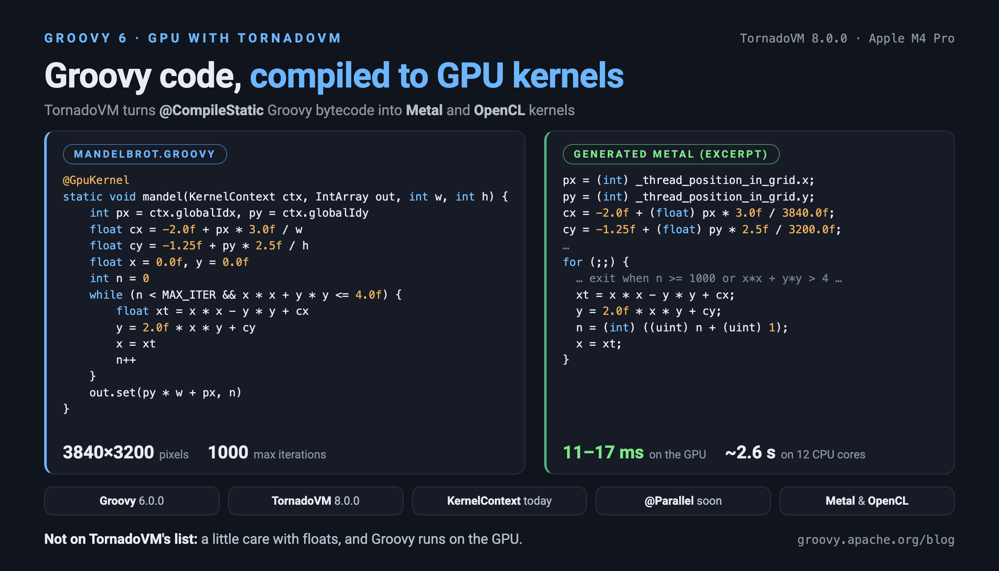
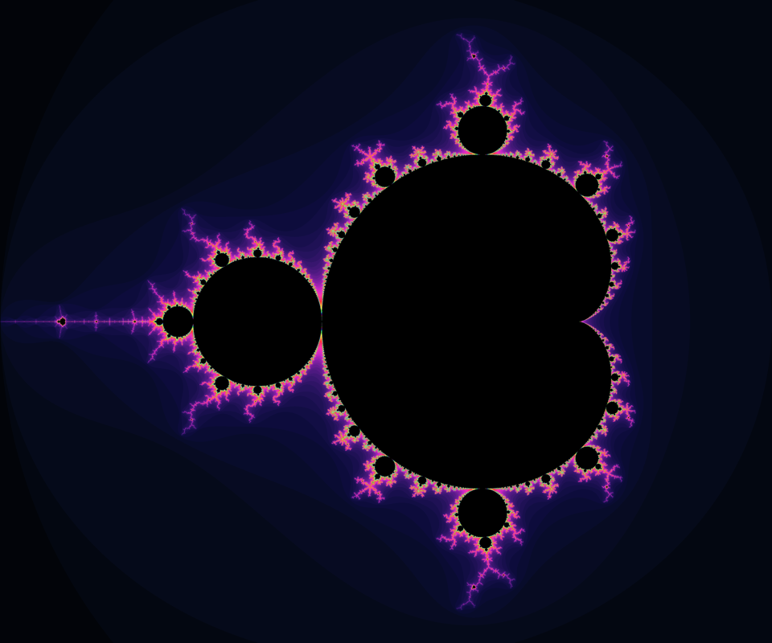

= Running Groovy on the GPU with TornadoVM
Paul King <paulk-asert|PMC_Member>
:revdate: 2026-10-28T08:00:00+00:00
:keywords: groovy, tornadovm, gpu, metal, opencl, apple silicon, kernelcontext, ast transformation, mandelbrot
:description: TornadoVM compiles Java bytecode to GPU kernels. We get Groovy code running on an Apple GPU with it today, and look at what upcoming Groovy fixes add.

== Introduction

> [blue]#TornadoVM compiles Java bytecode into GPU kernels. Its documentation talks about Java, but bytecode is bytecode. In this post we get Groovy code running on the GPU of an Apple M4 Pro, see which Groovy-isms get in the way and how to work around them, and look at what three upcoming Groovy fixes add.#

https://www.tornadovm.org[TornadoVM] JIT-compiles JVM bytecode
into OpenCL, CUDA and Apple Metal kernels
and runs them on GPUs and other accelerators.
Its 8.0.0 release replaced the Graal-based compiler it used to build on with
its own bytecode-to-kernel compiler, called TC, and moved the project to
the Apache License 2.0.

TornadoVM's FAQ says it "primarily supports Java" and that it
supports "a subset of the Java programming language". Groovy isn't mentioned.
But TornadoVM works from bytecode, and statically compiled Groovy produces
bytecode that is often very close to what javac produces. So, can we use it from Groovy?

In an link:matrix-calculations-with-groovy-apache.html[earlier post] we ran
matrix multiplication with cuBLAS, which needs an NVIDIA GPU, on a
Google Colab notebook. TornadoVM has a Metal backend, as well as OpenCL and CUDA,
so this time we can use the GPU in a Mac directly, and then run the same code on an NVIDIA GPU on Colab.

The example code is in the
https://github.com/paulk-asert/groovy-tornadovm[groovy-tornadovm]
companion repo.

== Setup

TornadoVM's runtime is distributed as an SDK with native drivers for each platform.
We used the `jdk21` Metal and OpenCL SDKs for macOS from the
https://github.com/beehive-lab/TornadoVM/releases/tag/v8.0.0[8.0.0 release]
with JDK 21. Both find the GPU:

----
$ tornado --devices
Number of Tornado drivers: 1
Driver: Metal
  Total number of Metal devices  : 1
  Tornado device=0:0  (DEFAULT)
	METAL --  [Apple Metal] -- Apple M4 Pro
		Global Memory Size: 48.0 GB
		Local Memory Size: 32.0 KB
		Workgroup Dimensions: 3
		Total Number of Block Threads: [1024]
		Max WorkGroup Configuration: [1024, 1024, 1024]
----

The `tornado` launcher sets up the module path and JVM flags; we add our classes and
the Groovy jar with `--classpath`. The companion repo wraps this in Gradle tasks.

== A first kernel

TornadoVM offers two ways to write a kernel. The _loop parallel API_ marks loops with
`@Parallel` and lets TornadoVM work out how to spread them across GPU threads.
The _KernelContext API_ is closer to CUDA or OpenCL: the kernel body runs once per GPU thread,
and asks the context for its thread index. We'll start with `KernelContext`, for reasons
we'll come to later.

Here is a vector add:

[source,groovy]
----
@CompileStatic
class VectorAdd {
    static void vectorAdd(KernelContext ctx, FloatArray a, FloatArray b, FloatArray c) {
        int i = ctx.globalIdx
        c.set(i, a.get(i) + b.get(i))
    }

    static void main(String[] args) {
        int size = 4096
        def a = new FloatArray(size), b = new FloatArray(size), c = new FloatArray(size)
        def r = new Random(42)
        for (int i = 0; i < size; i++) { a.set(i, r.nextFloat()); b.set(i, r.nextFloat()) }

        def ctx = new KernelContext()
        def graph = new TaskGraph('s0')
            .transferToDevice(FIRST_EXECUTION, a, b)
            .task('t0', VectorAdd::vectorAdd, ctx, a, b, c)
            .transferToHost(EVERY_EXECUTION, c)
        def grid = new GridScheduler('s0.t0', new WorkerGrid1D(size))
        try (def plan = new TornadoExecutionPlan(graph.snapshot())) {
            plan.withGridScheduler(grid).execute()
        }
        int bad = (0..<size).count { int i -> Math.abs(c.get(i) - (a.get(i) + b.get(i))) > 1e-6f } as int
        println "c[0..3] = ${(0..3).collect { int i -> c.get(i) }}, mismatches = $bad"
    }
}
----

The kernel is the `vectorAdd` method. A `TaskGraph` says which data moves to the
device, which kernel runs, and what comes back; a `GridScheduler` launches
one GPU thread per element. `FloatArray` is TornadoVM's off-heap array type.

It works, first time, with Groovy 6.0.0:

----
c[0..3] = [0.7822289, 0.7311627, 1.250793, 0.984789], mismatches = 0
----

With `--printKernel`, TornadoVM shows the Metal code it generated:

[source,c]
----
kernel void VectorAdd_vectorAdd(... device unsigned char *a [[buffer(4)]], ...)
{
  int i;
  device float *a_data, *b_data, *c_data;
  i = (int) _thread_position_in_grid.x;
  a_data = (device float *) (a + 16L);
  b_data = (device float *) (b + 16L);
  c_data = (device float *) (c + 16L);
  c_data[i] = a_data[i] + b_data[i];
}
----

Two things matter here. First, the class is `@CompileStatic`. TornadoVM finds the
kernel method by inspecting the method reference passed to `task`. With static compilation, Groovy
compiles `VectorAdd::vectorAdd` to the same serializable lambda javac would. Dynamic
Groovy creates a closure coerced to a proxy instead, and TornadoVM rejects it:

----
TornadoInternalError: Kernel entry jdk.proxy2.$Proxy10 has no writeReplace(): ...
----

Second, Groovy and Java don't quite agree about floats. In Groovy, `float + float`
is computed as a `double`, so the bytecode for `a.get(i) + b.get(i)` widens both values,
adds them as doubles, and narrows the result back to `float`. TornadoVM's compiler
recognised that pattern and generated a plain float add. For a single addition,
that's exact: a double has more than twice a float's precision, so rounding to double
and then to float gives the same answer as rounding to float directly. The same holds
for subtraction, multiplication and division.

== Floats get in the way

A vector add is a bit too simple, so let's render a Mandelbrot set. Each pixel is one GPU thread,
which iterates `z = z² + c` until `z` escapes or we give up:

[source,groovy]
----
static final int MAX_ITER = 1000

static void mandel(KernelContext ctx, IntArray out, int w, int h) {
    int px = ctx.globalIdx
    int py = ctx.globalIdy
    float cx = -2.0f + px * 3.0f / w
    float cy = -1.25f + py * 2.5f / h
    float x = 0.0f, y = 0.0f
    int n = 0
    while (n < MAX_ITER && x * x + y * y <= 4.0f) {
        float xt = x * x - y * y + cx
        y = 2.0f * x * y + cy
        x = xt
        n++
    }
    out.set(py * w + px, n)
}
----

This is where Groovy's numeric semantics bite, in three ways.

First, `@CompileStatic` refuses to compile it: `-2.0f + px * 3.0f / w` is a `double` in Groovy,
and assigning it to a `float` is a "possible loss of precision". We could add `as float` casts.

With the casts added, TornadoVM's compiler rejects the kernel:

----
TC-E1003 field Mandelbrot.$const$0 is not supported in kernels yet
----

Groovy moves `float` (and most `long`) literals into synthetic static fields named `$const$0`, `$const$1` and so on,
even `0.0f`. javac would use the constant directly. `int` and `double` literals are not moved.

Spelling every constant as `(float) 2.0d` gets past that, and leaves the arithmetic.
Expressions like `x * x + y * y` are now computed in double precision
throughout, and the GPU says no:

----
TC-E4012 this kernel uses double precision, which the device does not support
----

Apple GPUs have no 64-bit floating point. Nor would we want it here even if they did:
the point of writing the kernel with floats is that floats are fast on a GPU.

There is also a smaller issue: javac inlines `static final` primitive constants such as `MAX_ITER`,
while Groovy reads the field.

=== An AST transformation to the rescue

Recall that _one_ float operation, done in double precision and rounded straight back
to float, gives exactly the float result. So if every float operation is rounded back to
float as soon as it is done, we get Java's float arithmetic, bit for bit. We could write
the casts by hand, but they quickly make the code unreadable, for example
`(float) ((float) ((float) (x * x) - (float) (y * y)) + cx)`.

Groovy lets us have the compiler write them for us. `@GpuKernel` is a small AST
transformation (under 150 lines, in the companion repo) which runs before type checking. Within the annotated method it:

* wraps every `+`, `-`, `*` and `/` that has a `float` operand in a cast back to `float`,
  converting any `int` operand to `float` first, as javac would
* writes `float` literals as `(float) <double literal>`, which Groovy leaves in place,
  instead of moving them to a `$const$` field
* inlines `static final` primitive constants

Its core is an expression transformer:

[source,groovy]
----
if (e instanceof BinaryExpression && !(e instanceof DeclarationExpression)
        && e.operation.type in ARITH) {
    def left = transform(e.leftExpression)
    def right = transform(e.rightExpression)
    def lt = typeOf(left), rt = typeOf(right)
    if ((isFloat(lt) || isFloat(rt)) && isIntOrFloat(lt) && isIntOrFloat(rt)) {
        // int operands are widened to float first, as javac would
        def bin = new BinaryExpression(toFloat(left, lt), e.operation,
                toFloat(right, rt))
        bin.sourcePosition = e
        return castX(float_TYPE, bin)
    }
    ...
}
----

Because it runs before the type checker, it does its own small type inference:
declared types of variables and parameters, literals, casts, and the return types of
methods like `IntArray.get`. That covers kernel-style code; anything it can't work out
is left alone.

With `@GpuKernel` added to the `mandel` method above, and no other changes, the kernel compiles,
and TornadoVM generates plain float code:

[source,c]
----
px = (int) _thread_position_in_grid.x;
py = (int) _thread_position_in_grid.y;
cx = -2.0f + (float) px * 3.0f / 3840.0f;
cy = -1.25f + (float) py * 2.5f / 3200.0f;
...
xt = x * x - y * y + cx;
y = 2.0f * x * y + cy;
----

TornadoVM has also specialised the kernel for this launch:
`w` and `h` appear as the constants `3840` and `3200`. (`MAX_ITER` was already inlined by `@GpuKernel`.)

== Results

We rendered a 3840&#215;3200 image with up to 1000 iterations per pixel, and
compared it with the same Groovy code (also using `@GpuKernel`) on the CPU, both in a single thread and as a parallel
stream across the M4 Pro's 12 CPU cores. The GPU times exclude the first run, which
includes compiling the kernel. Times are from three runs of each:

[cols="3,2",options="header"]
|===
| Run | Time per image
| GPU, Metal | 11–17 ms
| GPU, OpenCL | 11–13 ms
| CPU, parallel stream, 12 cores | 2.4–2.9 s
| CPU, single thread | about 18.5 s
|===

The GPU is more than 100 times faster than all 12 CPU cores. Treat the
numbers as indicative: this is one machine and one kernel, and we haven't compared the
CPU numbers with an equivalent Java version.

The GPU image differs from the CPU one in 0.45% of its pixels, identically on Metal and OpenCL.
Near the boundary of the set the iteration is chaotic, and a difference in the last bit of
a float can change the iteration count. We didn't track down the exact cause, but GPU
compilers can apply floating-point optimisations, such as fused multiply-add, that the JVM doesn't.

=== On an NVIDIA GPU

Nothing above is specific to Apple hardware. The companion repo includes a
https://github.com/paulk-asert/groovy-tornadovm/blob/main/notebooks/tornadovm-cuda-colab.ipynb[Colab notebook]
which installs JDK 21 and TornadoVM's CUDA SDK for Linux, then runs the same Gradle tasks.
On a Colab runtime with an NVIDIA Tesla T4 (CUDA 13.0), TornadoVM found the GPU through its CUDA driver,
and the unchanged Groovy code produced this CUDA C for the vector add:

[source,c]
----
extern "C" __global__ void VectorAdd_vectorAdd(... unsigned char *a, unsigned char *b, unsigned char *c)
{
  int i;
  float *a_data, *b_data, *c_data;
  i = (int) (blockIdx.x * blockDim.x + threadIdx.x);
  a_data = (float *) (a + 16LL);
  b_data = (float *) (b + 16LL);
  c_data = (float *) (c + 16LL);
  c_data[i] = a_data[i] + b_data[i];
}
----

The Mandelbrot image took 16.8 ms on the T4, from a single run of the notebook.
(Colab runtimes have only two CPU cores, so the CPU timings there aren't a useful comparison.)
This time 0.28% of the pixels differed from the CPU result, and the total iteration count differs
slightly from the Apple GPU's. That fits the explanation above: each GPU compiler makes its own
floating-point choices, and the chaotic boundary of the set magnifies them.

== Coming soon: `@Parallel` loops

TornadoVM's other API is arguably the more natural one for Java and Groovy developers. You write
ordinary loops and mark the loop variables that can be spread over GPU threads with `@Parallel`:

[source,groovy]
----
@GpuKernel
static void mandel(IntArray out, int w, int h) {
    for (@Parallel int py = 0; py < h; py++) {
        for (@Parallel int px = 0; px < w; px++) {
            float cx = -2.0f + px * 3.0f / w
            float cy = -1.25f + py * 2.5f / h
            ...
            out.set(py * w + px, n)
        }
    }
}
----

With Groovy 6.0.0, this fails to compile at all, and trying to make it work turned up three
Groovy issues:

* link:https://issues.apache.org/jira/browse/GROOVY-12540[GROOVY-12540]:
  a `TYPE_USE` annotation, like `@Parallel`, on a local variable of primitive type crashes the
  compiler (`Adding type annotation @Parallel to non-redirect node: java.lang.Integer`).
* link:https://issues.apache.org/jira/browse/GROOVY-12541[GROOVY-12541]:
  with `@CompileStatic`, type annotations on local variables are silently left out of the class file,
  so TornadoVM would never see `@Parallel` anyway.
* link:https://issues.apache.org/jira/browse/GROOVY-12542[GROOVY-12542]:
  a comparison used as a loop condition, like `py < h`, is compiled to a `0`/`1` value that is then
  tested, where javac jumps on the comparison directly. TornadoVM's compiler only recognises a
  `@Parallel` loop, and works out its bounds, when the loop has javac's shape. Otherwise it reports
  `TC-E3103 the bounds of the @Parallel loops are not compile-time constants`.

Fixes for all three are expected in upcoming Groovy releases. The third makes Groovy's bytecode
smaller and closer to javac's in general, not just for TornadoVM. With a Groovy build that includes
them, the `@Parallel` versions of both examples run on Metal and OpenCL. They give the same results as
the `KernelContext` versions, at 17–21 ms per Mandelbrot image. TornadoVM turns each `@Parallel`
loop into a grid-stride loop, where each GPU thread starts at its own index and steps by the number of threads.
Here is the vector add:

[source,c]
----
i = (int) _thread_position_in_grid.x;
while (i < 4096) {
  v6 = (long) i;
  c_data[v6] = a_data[v6] + b_data[v6];
  v15 = v6 + v2;   // v2 is the global thread count
  i = (int) (v15 > 2147483647L ? 2147483647L : v15);
}
----

The third fix also tidies the `KernelContext` kernels. The `while` condition in the
Mandelbrot kernel no longer goes through an extra `0`/`1` flag variable in the generated Metal code.

== Caveats

This was an experiment rather than a supported configuration, so:

* We used macOS on an M4 Pro, with TornadoVM's Metal and OpenCL backends, and a single
  Colab run of the CUDA backend on a T4, all with JDK 21. We haven't tried other platforms.
* Kernels must be `@CompileStatic`, and should be written in the Java-like subset of Groovy that
  TornadoVM supports: primitives, TornadoVM's array types, simple loops and calls.
* `@GpuKernel` is a demo. Its type inference only covers the kind of code shown here.
* TornadoVM's kernel listings label source lines `Mandelbrot.java` rather than `Mandelbrot.groovy`. That's cosmetic.

== Conclusion

TornadoVM doesn't mention Groovy, but with Groovy 6.0.0 and TornadoVM 8.0.0 you can write GPU
kernels in Groovy today. Use `@CompileStatic` and the `KernelContext` API, and take care with floats:
Groovy's habit of widening float arithmetic to double, and moving float literals into fields, is
harmless on the JVM but not on a GPU without double precision. A small AST transformation
takes care of both and keeps the kernel code readable. The result renders a 3840&#215;3200 Mandelbrot
image in well under 20 ms on an Apple M4 Pro GPU, and the same code runs unchanged on an NVIDIA T4 through CUDA.

The more Java-like `@Parallel` loops need three Groovy fixes, which should arrive in upcoming
releases, and those fixes make Groovy's bytecode a little more javac-like along the way.

== Further information

* https://www.tornadovm.org[TornadoVM], its
  https://github.com/beehive-lab/TornadoVM[GitHub repository] and
  https://tornadovm.readthedocs.io[documentation]
* https://github.com/beehive-lab/TornadoVM/releases/tag/v8.0.0[TornadoVM 8.0.0 release]
* https://github.com/paulk-asert/groovy-tornadovm[groovy-tornadovm] companion repo, including the
  https://colab.research.google.com/github/paulk-asert/groovy-tornadovm/blob/main/notebooks/tornadovm-cuda-colab.ipynb[CUDA notebook for Colab]
* link:https://issues.apache.org/jira/browse/GROOVY-12540[GROOVY-12540],
  link:https://issues.apache.org/jira/browse/GROOVY-12541[GROOVY-12541] and
  link:https://issues.apache.org/jira/browse/GROOVY-12542[GROOVY-12542]
* link:matrix-calculations-with-groovy-apache.html[Matrix calculations with Groovy], including cuBLAS on a GPU
* link:../releasenotes/groovy-6.0.html[Groovy 6.0 release notes]
