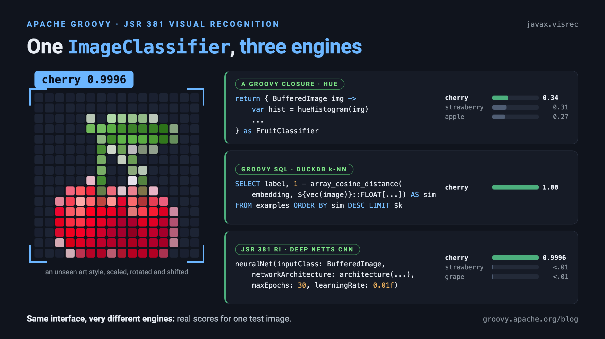
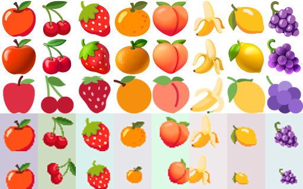

= Fruity Visual Recognition with Groovy&reg; and JSR 381
Paul King <paulk-asert|PMC_Member>; Geertjan Wielenga <geertjanw|ASF_Member>
:revdate: 2026-11-27T08:00:00+00:00
:draft: true
:keywords: groovy, jsr 381, visrec, visual recognition, image classification, deep netts, duckdb, groovy sql, ginq, emoji, machine learning, deep learning
:description: Classifying fruit emoji with Groovy and the JSR 381 VisRec API: a closure, a DuckDB nearest-neighbour search and a Deep Netts CNN behind one interface.

== Introduction

> [blue]#JSR 381 gives Java a standard interface for image classifiers. In this post we put three very different engines behind that one interface, a Groovy closure, a nearest-neighbour search in DuckDB and a convolutional neural network, and see which of them can tell an apple from a cherry.#

https://jcp.org/en/jsr/detail?id=381[JSR 381], the Visual Recognition (VisRec) Specification,
reached Final Release in February 2022. It defines a small API for classifying images (and other
data) that different machine learning engines can implement.
An earlier post, https://groovy.apache.org/blog/classifying-iris-flowers-with-deep[Classifying Iris Flowers with Deep Learning],
used the https://www.deepnetts.com/[Deep Netts] implementation of JSR 381 on tabular data.
Geertjan's recent Foojay.io article
https://foojay.io/today/jsr-381-java-visual-recognition-api/[JSR 381: Java Visual Recognition API]
looked at the image side of the API from Java. It trained the reference implementation and
then wrote a second `ImageClassifier` of its own: images shrunk to 8x8 pixels, stored in
https://duckdb.org/[DuckDB], and classified by a nearest-neighbour vote.

This post takes up that idea of swapping engines behind one interface. Instead of cats and dogs, or
sunsets and forests, we'll use fruit, as in our earlier
https://groovy.apache.org/blog/fruity-eclipse-collections[Fruity Eclipse Collections] post. Groovy makes each engine short
enough that we can afford to compare three of them.

All the code is in the https://github.com/paulk-asert/groovy-visrec[groovy-visrec] repo.

== The JSR 381 API in brief

The core interface is tiny:

[source,java]
----
public interface Classifier<T, R> {
    R classify(T input) throws ClassificationException;
}
----

`ImageClassifier<IMAGE_CLASS>` extends it with a result type of `Map<String, Float>`
(label to confidence) and adds two convenience overloads, `classify(Path)` and `classify(InputStream)`.
For neural networks there is also a builder, `NeuralNetImageClassifier.builder()`, which finds an
implementation using the Java `ServiceLoader`. The reference implementation is backed by Deep Netts.

== The data

We'll use eight fruit: 🍎 🍒 🍓 🍊 🍑 🍌 🍋 🍇. The first six are the ones from the earlier fruity posts.
Strawberry and lemon join them because they look a lot like the apple and the banana.
Each fruit comes in three emoji art styles, which form the first three rows of the image below:
https://github.com/googlefonts/noto-emoji[Noto Color Emoji] in its 2D and 3D variants,
and https://github.com/jdecked/twemoji[Twemoji].

One image per fruit per style isn't much of a training set, so we make more. Each copy gets a random
pale background, a rotation, a zoom and a shift. The last two rows of the image above show one
example each of the two levels used later, _easy_ and _hard_:

[source,groovy]
----
static final Map<String, Map<String, Range<BigDecimal>>> LEVELS = [
    easy: [rotate: -30..30, scale: 0.7..1.0, shift: -0.1..0.1],
    hard: [rotate: -90..90, scale: 0.4..1.0, shift: -0.25..0.25]
]

static List<Example> augmented(String style, int perFruit, long seed, String level = 'easy') {
    var rnd = new Random(seed)
    Closure<Double> between = { double lo, double hi -> lo + rnd.nextDouble() * (hi - lo) }
    Closure<Double> pick = { Range r -> between(r.from, r.to) }
    var aug = LEVELS[level]
    Fruit.values().collectMany { fruit ->
        var src = source(style, fruit)
        (1..perFruit).collect {
            var tint = Color.getHSBColor(rnd.nextFloat(), between(0, 0.15) as float, between(0.85, 1) as float)
            var img = src.transform(size: SIZE, background: tint,
                    rotate: pick(aug.rotate), scale: pick(aug.scale),
                    dx: pick(aug.shift), dy: pick(aug.shift))
            new Example(fruit, style, img)
        }
    }
}
----

`transform` isn't a JDK method on `BufferedImage`. It's one of a handful of
https://groovy-lang.org/metaprogramming.html#_extension_modules[extension methods]
in the repo, which make images feel like Groovy collections. For example, `img[x, y]` returns a pixel's
`Color`, and `img.pixels` returns them all:

[source,groovy]
----
static Color getAt(BufferedImage self, List<Integer> xy) {
    new Color(self.getRGB(xy[0], xy[1]), true)
}

static List<Color> getPixels(BufferedImage self) {
    (0..<self.height).collectMany { y -> (0..<self.width).collect { x -> self[x, y] } }
}
----

We train on 60 augmented copies of each fruit in two of the styles, and test on 20 fresh copies
(different random seeds) from both the same two styles and the third, _unseen_ style.

== Engine 1: a closure is a classifier

`ImageClassifier` has three abstract methods, but two of them just load an image and call the first.
A Groovy trait can supply those two, leaving a single abstract method:

[source,groovy]
----
trait FruitClassifier implements ImageClassifier<BufferedImage> {
    Map<String, Float> classify(Path path) { classify(ImageIO.read(path.toFile())) }

    Map<String, Float> classify(InputStream input) { classify(ImageIO.read(input)) }
}
----

Groovy can coerce a closure to any interface or trait with one abstract method. So any closure taking
a `BufferedImage` is now a complete JSR 381 classifier.

For our first engine, we'll use colour alone. We build a 12-bin hue histogram of the pixels that differ from
the background (the background colour is taken from the corner pixel, `self[0, 0]`), average the histograms of
each fruit's training images, and pick the fruit whose average is closest:

[source,groovy]
----
static FruitClassifier hue(List<Example> training) {
    Map<Fruit, double[]> centroids = training.groupBy { it.fruit }.collectEntries { fruit, examples ->
        var hists = examples.collect { hueHistogram(it.image) }
        [fruit, (0..<BINS).collect { i -> hists.sum { it[i] } / hists.size() } as double[]]
    }
    return { BufferedImage img ->
        var hist = hueHistogram(img)
        var sims = centroids.collectEntries { fruit, c -> [fruit.label, Math.max(cosine(hist, c), 0)] }
        double total = sims.values().sum()
        sims.collectEntries { label, sim -> [label, (sim / total) as float] }
            .sort { -it.value }
    } as FruitClassifier
}
----

The fruity Eclipse Collections post found that fruit emoji are mostly the colour you'd expect.
We'll see shortly how far that gets us.

== Engine 2: nearest neighbours in DuckDB

The second engine follows the Foojay.io article. Each image is shrunk to 8x8 pixels, giving a vector of
192 RGB values (an _embedding_), which is another extension method:

[source,groovy]
----
static float[] embedding(BufferedImage self, int size = 8) {
    self.scaled(size).pixels.collectMany { c -> [c.red, c.green, c.blue].collect { it / 255f } } as float[]
}
----

Training stores the embeddings in an in-memory DuckDB table. Classifying finds the five stored images most
similar to the new one (by cosine similarity) and lets them vote, weighted by similarity.
With https://groovy-lang.org/databases.html[Groovy SQL], both the nearest-neighbour search and the vote
are one query, and the GString placeholders become JDBC bind parameters:

[source,groovy]
----
class DuckDbFruitClassifier implements FruitClassifier, AutoCloseable {
    private final Sql sql = Sql.newInstance('jdbc:duckdb:')
    private final Function<BufferedImage, float[]> embedder
    private final int dims, k

    DuckDbFruitClassifier(int dims, int k = 5, Function<BufferedImage, float[]> embedder) {
        this.dims = dims
        this.k = k
        this.embedder = embedder
        sql.execute "CREATE TABLE examples(label VARCHAR, embedding FLOAT[$dims])".toString()
    }

    private vec(BufferedImage image) {
        sql.connection.createArrayOf('FLOAT', embedder.apply(image) as Float[])
    }

    void learn(List<Example> examples) {
        sql.withBatch(100, 'INSERT INTO examples VALUES (?, ?)') { ps ->
            examples.each { ps.addBatch(it.fruit.label, vec(it.image)) }
        }
    }

    Map<String, Float> classify(BufferedImage image) {
        sql.rows("""
            WITH nearest AS (
                SELECT label, 1 - array_cosine_distance(embedding, ${vec(image)}::FLOAT[${Sql.expand(dims)}]) AS sim
                FROM examples ORDER BY sim DESC LIMIT $k
            )
            SELECT label, sum(sim) / (SELECT sum(sim) FROM nearest) AS score
            FROM nearest GROUP BY label ORDER BY score DESC
        """).collectEntries { [it.label, it.score as float] }
    }

    void close() { sql.close() }
}
----

The array size can't be a bind parameter, so `Sql.expand` writes it into the SQL text instead.
The embedder is passed in as a function, so the same class would work with any other way of
turning images into vectors.

If you've read https://groovy.apache.org/blog/groovy-oracle23ai[Using the Oracle 23ai Vector data type with Groovy],
this will look familiar: there the nearest-neighbour vote over Iris measurements ran in Oracle using
`vector_distance(features, $features, EUCLIDEAN)`. DuckDB's `array_cosine_distance` is the same measure as
Oracle's `COSINE` option (one minus the cosine similarity). Here it works on fixed-size `FLOAT[n]` arrays
rather than a dedicated `VECTOR` type.

== Engine 3: a convolutional neural network

The third engine is the JSR 381 reference implementation, which trains a Deep Netts convolutional
neural network. It reads its network architecture from a JSON file, which we write with `JsonBuilder`:

[source,groovy]
----
static File architecture(File dir, int size, int classes) {
    new File(dir, 'fruit_arch.json').tap {
        text = new JsonBuilder(
            networkType: 'CONVOLUTIONAL',
            lossFunction: 'CROSS_ENTROPY',
            layers: [
                [layerType: 'INPUT', width: size, height: size, channels: 3],
                [layerType: 'CONVOLUTIONAL', filterWidth: 3, filterHeight: 3, channels: 8, stride: 1, activation: 'RELU'],
                [layerType: 'MAXPOOLING', filterWidth: 2, filterHeight: 2, stride: 2],
                [layerType: 'CONVOLUTIONAL', filterWidth: 3, filterHeight: 3, channels: 16, stride: 1, activation: 'RELU'],
                [layerType: 'MAXPOOLING', filterWidth: 2, filterHeight: 2, stride: 2],
                [layerType: 'FULLY_CONNECTED', width: 32, activation: 'RELU'],
                [layerType: 'OUTPUT', width: classes, activation: 'SOFTMAX']
            ]
        ).toPrettyString()
    }
}
----

The builder takes options like `imageWidth(32)` and `maxEpochs(30)`. It's tempting to configure it
inside Groovy's `with { }`, but there's a catch: `inputClass(...)` returns a _new_ builder, so any options
set on the original one are silently lost. Instead, we pass the options as a map and fold them
into the builder with `inject`, which always carries forward whatever builder the previous call returned:

[source,groovy]
----
static ImageClassifier<BufferedImage> neuralNet(Map options) {
    options.inject(NeuralNetImageClassifier.builder()) { builder, option, value ->
        builder."$option"(value)
    }.build()
}

static ImageClassifier<BufferedImage> cnn(List<Example> training, int epochs = 30) {
    var dir = new File('build/dataset/train')
    var index = Dataset.writeIndex(training, dir)
    neuralNet(
        inputClass: BufferedImage,
        imageWidth: Dataset.SIZE,
        imageHeight: Dataset.SIZE,
        labelsFile: Path.of(dir.path, 'labels.txt'),
        trainingFile: index.toPath(),
        networkArchitecture: architecture(dir, Dataset.SIZE, Fruit.values().size()).toPath(),
        exportModel: Path.of('build/fruit.dnet'),
        maxError: 0.02f,
        maxEpochs: epochs,
        learningRate: 0.01f
    )
}
----

The reference implementation reads its training images from disk, so `writeIndex` saves them
as PNG files along with an index file of `path label` lines.

== Comparing the engines with GINQ

All three engines are now just `ImageClassifier` instances, so a single evaluation loop handles them all,
recording a `Prediction` for every test image:

[source,groovy]
----
record Prediction(String classifier, String test, Fruit actual, Fruit predicted, float score) {
    boolean isCorrect() { actual == predicted }
}

List<Prediction> predictions = factories.collectMany { name, factory ->
    var classifier = factory()
    tests.collectMany { test, examples ->
        examples.collect { ex ->
            var best = classifier.classify(ex.image).max { it.value }
            new Prediction(name, test, ex.fruit, Fruit.of(best.key), best.value)
        }
    }
}
----

https://groovy-lang.org/using-ginq.html[GINQ] then summarises the results:

[source,groovy]
----
println GQ {
    from p in predictions
    groupby p.classifier, p.test
    orderby p.classifier, p.test
    select p.classifier, p.test, count() as n, Math.round(avg(p.correct ? 100 : 0)) as accuracy
}
----

Training on augmented Noto 2D and Twemoji images, and testing on those styles plus Noto 3D, gives:

[source]
----
+------------+--------------+-----+----------+
| classifier | test         | n   | accuracy |
+------------+--------------+-----+----------+
| cnn        | seen styles  | 320 | 100      |
| cnn        | unseen style | 160 | 99       |
| hue        | seen styles  | 320 | 68       |
| hue        | unseen style | 160 | 88       |
| pixel      | seen styles  | 320 | 96       |
| pixel      | unseen style | 160 | 96       |
+------------+--------------+-----+----------+
----

Another GINQ query lists the most common mistakes:

[source,groovy]
----
println GQ {
    from p in predictions
    where !p.correct
    groupby p.classifier, p.actual, p.predicted
    orderby count() in desc
    limit 8
    select p.classifier, "$p.actual → $p.predicted" as mistake, count() as n
}
----

[source]
----
+------------+---------+----+
| classifier | mistake | n  |
+------------+---------+----+
| hue        | 🍎 → 🍑 | 40 |
| hue        | 🍎 → 🍒 | 20 |
| hue        | 🍓 → 🍒 | 20 |
| hue        | 🍓 → 🍑 | 20 |
| hue        | 🍊 → 🍌 | 19 |
| pixel      | 🍎 → 🍑 | 5  |
| pixel      | 🍓 → 🍎 | 4  |
| hue        | 🍋 → 🍊 | 2  |
+------------+---------+----+
----

Colour alone mixes up the red fruit, and the orange and the banana, much as the fruity Eclipse Collections
post would lead us to expect. It didn't classify a single apple correctly: each one came out as a peach or a cherry.

== Making it harder

Here are the accuracy figures (%) from three setups: the two choices of unseen style with easy augmentation, and hard augmentation:

[cols="3,1,1,1",options="header"]
|===
|Experiment |Colour |Pixel k-NN |CNN
|Easy augmentation, unseen style Noto 3D |88 |96 |99
|Easy augmentation, unseen style Twemoji |30 |82 |88
|Hard augmentation, seen styles |69 |60 |90
|Hard augmentation, unseen style Noto 3D |87 |60 |84
|===

The Foojay.io article says the 8x8 pixel embedding isn't suited to telling apart shapes, like cats and dogs.
With easy augmentation, though, it scores 96%: each emoji design is always drawn the same way, so the
tiny thumbnails differ little between copies. With hard augmentation, the fruit move around, change
size and turn sideways, and the pixel engine drops to 60%. The CNN holds up much better (90%), since
its convolution and pooling layers respond to local patterns wherever they appear in the image.
It needed 50 training epochs rather than 30 to get there.

Colour behaves in the opposite way. A hue histogram doesn't care where the fruit is or which way up
it is, so the hard augmentation barely affects it, and on the hard unseen Noto 3D test it
even edges out the CNN. But Twemoji uses a different palette, and colour drops to 30% when that
style is held out.

Changing art style hurts every engine. The CNN's one consistent failure with Twemoji held out is the
strawberry, which it calls an apple in 17 of 20 cases:

[source]
----
cnn / unseen style
     🍎  🍒  🍓  🍊  🍑  🍌  🍋  🍇
 🍎  19   .   .   .   .   .   .   1
 🍒   .  20   .   .   .   .   .   .
 🍓  17   .   2   .   .   .   .   1
 🍊   .   .   .  20   .   .   .   .
 🍑   .   .   .   .  20   .   .   .
 🍌   .   .   .   .   .  20   .   .
 🍋   .   .   .   .   .   .  20   .
 🍇   .   .   .   .   .   .   .  20
----

Looking at the third row of the image at the top, the Twemoji strawberry is a plain red shape
with a green top, not so far from the Noto apples the CNN was trained on.

== Things to know

A few things to be aware of if you try this yourself:

* The reference implementation, `javax.visrec:visrec-ri:1.0.3`, depends on Deep Netts 1.13.2, which in turn
  brings in log4j 2.7. That version is affected by
  https://nvd.nist.gov/vuln/detail/CVE-2021-44228[CVE-2021-44228], so the repo's build forces a current log4j.
* The reference implementation and Deep Netts are GPL-licensed with the Classpath Exception.
* The builder needs a `networkArchitecture` JSON file, in addition to the options shown in most examples.
* The DuckDB JDBC driver doesn't accept a Java `float[]` as a parameter. `Connection.createArrayOf` works.
* The accuracy query above needs Groovy 6.0.1 or later. In Groovy 6.0.0, giving a GINQ alias to a
  method call that involves an aggregate, such as `Math.round(avg(n)) as mean`, fails to compile
  (https://issues.apache.org/jira/browse/GROOVY-12833[GROOVY-12833]).
  On 6.0.0, a cast, `(avg(n) as int) as mean`, works instead.

== Conclusion

JSR 381 keeps the classifier interface small, and Groovy makes it cheap to put something behind it:
a closure, a SQL query, or a neural network configured from a map.
That made it easy to compare the three and to learn something about each: colour is robust to
position but not to style, pixel thumbnails are better than their reputation when images are consistent,
and a small CNN handles the harder cases best.

== Further information

* https://jcp.org/en/jsr/detail?id=381[JSR 381: Visual Recognition (VisRec) Specification]
* https://foojay.io/today/jsr-381-java-visual-recognition-api/[JSR 381: Java Visual Recognition API] on Foojay.io
* https://github.com/JavaVisRec[JavaVisRec] on GitHub: the API, reference implementation and examples
* https://www.deepnetts.com/[Deep Netts]
* https://duckdb.org/[DuckDB]
* https://github.com/paulk-asert/groovy-visrec[groovy-visrec] companion repo
* https://groovy.apache.org/blog/classifying-iris-flowers-with-deep[Classifying Iris Flowers with Deep Learning, Groovy and GraalVM]
* https://groovy.apache.org/blog/groovy-oracle23ai[Using the Oracle 23ai Vector data type with Groovy to classify Iris flowers]
* https://groovy.apache.org/blog/fruity-eclipse-collections[Fruity Eclipse Collections]

Emoji images: https://github.com/googlefonts/noto-emoji[Noto Emoji] (Apache License 2.0) and
https://github.com/jdecked/twemoji[Twemoji] (graphics licensed under
https://creativecommons.org/licenses/by/4.0/[CC-BY 4.0]).
