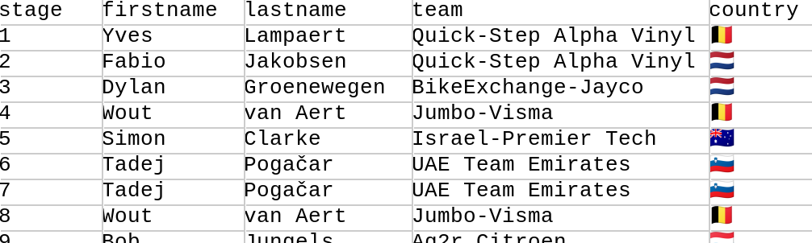
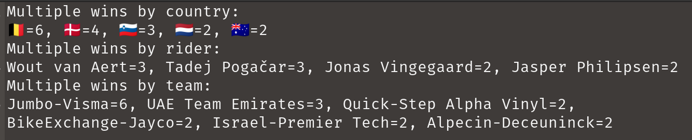
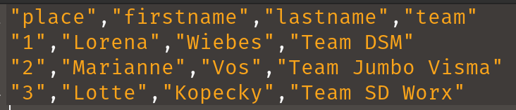

= Reading and Writing CSV files with Groovy&reg;
Paul King
:revdate: 2022-07-25T14:26:20+00:00
:updated: 2026-08-26T10:00:00+00:00
:keywords: csv, data, deserialization, files, groovy, reading, records, data science, serialization, writing, groovy-csv, csvslurper, csvbuilder, opencsv, commons csv, jackson databind, cycling
:description: This post looks at processing CSV files using Groovy's groovy-csv module, along with the OpenCSV, Apache Commons CSV, and Jackson Databind libraries.

image:img/csv_typed.png["Reading a CSV file by hand with split versus reading it into records with Groovy's CsvSlurper",width=800]

== Introduction

In this post, we'll look at reading and writing CSV
files using Groovy.

=== Aren't CSV files just text files?

For simple cases, we can treat CSV files no differently than we
would other text files. Suppose we have the following data that
we would like to write to a CSV file:

[source,groovy]
----
def data = [
        ['place', 'firstname', 'lastname', 'team'],
        ['1', 'Lorena', 'Wiebes', 'Team DSM'],
        ['2', 'Marianne', 'Vos', 'Team Jumbo Visma'],
        ['3', 'Lotte', 'Kopecky', 'Team SD Worx']
]
----

Groovy uses `File` or `Path` objects similar to Java.
We'll use a `File` object here and, for our purposes, we'll
just use a temporary file since we are just going to read it
back in and check it against our data. Here is how to create
a temporary file:

[source,groovy]
----
def file = File.createTempFile('FemmesStage1Podium', '.csv')
----

Writing our CSV (in this simple example) is as simple as joining
the data with commas and the lines with line separator character(s):

[source,groovy]
----
file.text = data*.join(',').join(System.lineSeparator())
----

Here we "wrote" the entire file contents in one go but there
are options for writing a line or character or byte at a time.

Reading the data in is just as simple. We read the lines and
split on commas:

[source,groovy]
----
assert file.readLines()*.split(',') == data
----

In general, we might want to further process the data.
Groovy provides nice options for this too. Suppose we have
the following existing CSV file:

We can read in the file and select various columns of interest
with code like below:

[source,groovy]
----
def file = new File('HommesStageWinners.csv')
def rows = file.readLines().tail()*.split(',')
int total = rows.size()
Set names = rows.collect { it[1] + ' ' + it[2] }
Set teams = rows*.getAt(3)
Set countries = rows*.getAt(4)
String result = "Across $total stages, ${names.size()} riders from " +
        "${teams.size()} teams and ${countries.size()} countries won stages."
assert result == 'Across 21 stages, 15 riders from 10 teams and 9 countries won stages.'
----

Here, the `tail()` method skips over the header line.
Column 0 contains the stage number which we ignore.
Column 1 contains the first name, column 2 the last name,
column 3 the team, and column 4 the country of the rider.
We store away the full names, teams and countries in sets
to remove duplicates. We then create an overall result
message using the size of those sets.

While for this simple example, the coding was fairly simple,
it isn't recommended to hand process CSV files in this fashion.
The details for CSV can quickly get messy. What if the values
themselves contain commas or newlines? Perhaps we can surround in
double quotes but then what if the value contains a double quote?
And so forth. For this reason, CSV libraries are recommended.

We'll look at four shortly, but first let's summarise some of
the highlights of the tour by looking at multiple winners.
Here is some code which summarises our CSV data:

[source,groovy]
----
def byValueDesc = { -it.value }
def bySize = { k, v -> [k, v.size()] }
def isMultiple = { it.value > 1 }
def multipleWins = { Closure select -> rows
    .groupBy(select)
    .collectEntries(bySize)
    .findAll(isMultiple)
    .sort(byValueDesc)
    .entrySet()
    .join(', ')
}
println 'Multiple wins by country:\n' + multipleWins{ it[4] }
println 'Multiple wins by rider:\n' + multipleWins{ it[1] + ' ' + it[2] }
println 'Multiple wins by team:\n' + multipleWins{ it[3] }
----

This summary has nothing in particular to do with CSV files but
is summarised in honour of the great riding during the tour!
Here's the output:

Okay, now let's look at our four CSV options, starting with the
one which comes with Groovy itself.

== Groovy's CSV module

Groovy 6 added an optional `groovy-csv` module
(https://issues.apache.org/jira/browse/GROOVY-11923[GROOVY-11923])
containing `CsvSlurper` and `CsvBuilder` classes in the `groovy.csv`
package. If you have used `JsonSlurper`/`JsonBuilder` or
`XmlSlurper`/`XmlBuilder`, the naming and the style will look familiar.
Being an optional module, we need to add it to our build, or for a
script:

[source,groovy]
----
@Grab('org.apache.groovy:groovy-csv:6.0.0-beta-3')
----

Under the covers, `groovy-csv` currently builds on the CSV support in
https://github.com/FasterXML/jackson-databind[Jackson Databind], which
we'll be looking at directly later in this post. That is an
implementation detail rather than part of the module's API, and it
stays mostly out of sight, but a few hints reveal it here and there —
most visibly in the annotations recognised when reading and writing
typed objects. In theory the underlying library could change, though
that happens only rarely, and never without considering the porting
options for existing users.

This module is row-oriented rather than line-oriented: `CsvBuilder`
writes a collection of maps, and `CsvSlurper` reads back a list of maps
keyed by the header names. So, we'll express our podium data like this:

[source,groovy]
----
def data = [
    [place: 1, firstname: 'Lorena',   lastname: 'Wiebes',  team: 'Team DSM'],
    [place: 2, firstname: 'Marianne', lastname: 'Vos',     team: 'Team Jumbo Visma'],
    [place: 3, firstname: 'Lotte',    lastname: 'Kopecky', team: 'Team SD Worx']
]
----

Writing it is a one-liner, with the keys of the first map becoming the
header row:

[source,groovy]
----
file.text = CsvBuilder.toCsv(data)
----

That gives us:

[source]
----
place,firstname,lastname,team
1,Lorena,Wiebes,"Team DSM"
2,Marianne,Vos,"Team Jumbo Visma"
3,Lotte,Kopecky,"Team SD Worx"
----

Reading it back needs no configuration, since treating the first row as
a header is the default:

[source,groovy]
----
def podium = new CsvSlurper().parse(file)
assert podium[0].firstname == 'Lorena'
assert podium*.team.toSet().size() == 3
----

As well as `parseText` for a String, there are `parse` overloads taking
a `Reader`, `InputStream`, `File` or `Path`, each with an optional
`Charset`.

Our more elaborate example needs no extra work to skip or interpret the
header row, and like the other libraries, we can process using column
names:

[source,groovy]
----
def rows = new CsvSlurper().parse(new File('HommesStageWinners.csv'))
assert rows.size() == 21
assert rows.collect { it.firstname + ' ' + it.lastname }.toSet().size() == 15
assert rows*.team.toSet().size() == 10
assert rows*.country.toSet().size() == 9
----

The messy details we worried about earlier are handled for us. Fields
containing the separator, newlines or quotes are quoted on the way out
and unquoted on the way in, with embedded quotes doubled, as per
RFC 4180:

[source,groovy]
----
def csv = '''\
name,quote
"Vos, Marianne","She said ""go"""
'''
def row = new CsvSlurper().parseText(csv)[0]
assert row.name == 'Vos, Marianne'
assert row.quote == 'She said "go"'
----

If your data doesn't use commas and double quotes, fluent setters
change that:

[source,groovy]
----
assert new CsvSlurper().setSeparator('\t' as char)
        .parseText('a\tb\n1\t2') == [[a: '1', b: '2']]
----

`CsvBuilder` has matching `setSeparator` and `setQuoteChar` setters and
implements `Writable`, so it can be handed straight to a writer:

[source,groovy]
----
file.withWriter { w -> new CsvBuilder()(data).writeTo(w) }
----

=== Typed parsing

CSV has no types of its own, every cell is just text, so the `parse`
methods hand back `String` values. That is often what we want, but when
it isn't, the `parseAs` method converts rows into typed objects. We
describe the shape we want with a record:

[source,groovy]
----
record Cyclist(int stage,
               @JsonProperty('firstname') String first,
               @JsonProperty('lastname') String last,
               String team, String country) {
    String full() { "$first $last" }
}
----

And then read our file directly into records:

[source,groovy]
----
List<Cyclist> cyclists = new CsvSlurper().parseAs(Cyclist, new File('HommesStageWinners.csv'))
assert cyclists.size() == 21
assert cyclists*.full().toSet().size() == 15
assert cyclists*.team.toSet().size() == 10
assert cyclists*.country.toSet().size() == 9
assert cyclists[0].stage == 1    // an int, not a String
----

This is one of those places where the Jackson underpinnings show
through: `@JsonProperty` is a Jackson annotation. We only need it for
the two components whose names don't match their column, and `stage`
arrives as an `int` without any help. We'll meet the same annotations
again in the Jackson Databind section later, but here we don't
assemble a `CsvMapper` and a `CsvSchema` ourselves. Conversion isn't
limited to numbers, `java.time` types work too, with `@JsonFormat`
where the pattern isn't the default:

[source,groovy]
----
record Sale(String customer, BigDecimal amount,
            @JsonFormat(pattern = 'yyyy-MM-dd') LocalDate date) { }

def sales = new CsvSlurper().parseAs(Sale,
        'customer,amount,date\nAcme,1500.00,2026-03-01\nGlobex,250.50,2026-03-02')
assert sales*.amount.sum() == 1750.50
assert sales[0].date.monthValue == 3
----

Writing typed objects back out is `CsvBuilder.toCsv(data, type)`. If
the column order matters, `@JsonPropertyOrder` on the type pins it
explicitly. Without it, columns follow Jackson's own ordering, which is
alphabetical; from 6.0.0-beta-4 onwards records instead keep their
component declaration order
(https://issues.apache.org/jira/browse/GROOVY-12296[GROOVY-12296]),
while other classes stay alphabetical. The annotation gives the same
result either way.

=== Revisiting the summary

Now that our rows are records, we can revisit the multiple wins summary
from earlier. The grouping key becomes the interesting part of the line
rather than a column index, and `countBy` does in one step what
`groupBy` followed by a size mapping did before, so the `bySize` helper
has no equivalent here:

[source,groovy]
----
def multipleWins = { Closure select -> cyclists
    .countBy(select)
    .findAll { it.value > 1 }
    .sort { -it.value }
    .entrySet()
    .join(', ')
}
println 'Multiple wins by country:\n' + multipleWins{ it.country }
println 'Multiple wins by rider:\n' + multipleWins{ it.full() }
println 'Multiple wins by team:\n' + multipleWins{ it.team }
----

The output is identical to the earlier version, but nothing in the
processing depends any more on which position a column happens to
occupy in the file.

image:img/csv_summary.png["The multiple wins summary rewritten with records and countBy, alongside its output",width=800]

Groovy's `groovy-ginq` module is worth a mention here too. GINQ can
group by several keys at once, so the team and country travel along
with the rider, and a second aggregate comes with them in the same
pass:

[source,groovy]
----
def repeatWinners = GQ {
    from c in cyclists
    groupby c.full() as rider, c.team as team, c.country as country
    having count() > 1
    orderby count() in desc, rider
    select rider, team, country, count() as wins, max(c.stage) as lastWin
}
repeatWinners.each {
    println "$it.wins wins  $it.rider ($it.team, $it.country), last on stage $it.lastWin"
}
----

which gives us:

[source]
----
3 wins  Tadej Pogačar (UAE Team Emirates, 🇸🇮), last on stage 17
3 wins  Wout van Aert (Jumbo-Visma, 🇧🇪), last on stage 20
2 wins  Jasper Philipsen (Alpecin-Deceuninck, 🇧🇪), last on stage 21
2 wins  Jonas Vingegaard (Jumbo-Visma, 🇩🇰), last on stage 18
----

Doing that with closures means holding on to a representative element
for each group and re-extracting the other columns from it.

The module is incubating in Groovy 6, so we'd love your feedback. The
dochome6:csv-userguide.html[Processing CSV user guide] has the full API.

== Commons CSV

The https://commons.apache.org/proper/commons-csv/[Apache Commons CSV] library makes writing and parsing CSV files easier.
Here is the code for writing our CSV which makes use of the
`CSVPrinter` class:

[source,groovy]
----
file.withWriter { w ->
    new CSVPrinter(w, CSVFormat.DEFAULT).printRecords(data)
}
----

And here is the code for reading it back in which uses
the `RFC4180` parser factory singleton:

[source,groovy]
----
file.withReader { r ->
    assert RFC4180.parse(r).records*.toList() == data
}
----

There are other singleton factories for tab-separated values
and other common formats and builders to let you set a whole
variety of options like escape characters, quote options,
whether to use an enum to define header names, and whether
to ignore empty lines or nulls.

For our more elaborate example, we have a tiny bit more work
to do. We'll use the builder to tell the parser to skip the
header row. We could have chosen to use the `tail()` trick we
used earlier, but we decided to use the parser features instead.
The code would look like this:

[source,groovy]
----
file.withReader { r ->
    def rows = RFC4180.builder()
            .setHeader()
            .setSkipHeaderRecord(true)
            .build()
            .parse(r)
            .records
    assert rows.size() == 21
    assert rows.collect { it.firstname + ' ' + it.lastname }.toSet().size() == 15
    assert rows*.team.toSet().size() == 10
    assert rows*.country.toSet().size() == 9
}
----

You can see here that we have used column names rather than
column numbers during our processing. Using column names is
another advantage of using the CSV library; it would be quite
a lot of work to do that aspect by hand. Also note that,
for simplicity, we didn't create the entire _result_ message
as in the earlier example. Instead, we just checked the size
of all the relevant sets that we calculated previously.

== OpenCSV

The http://opencsv.sourceforge.net/[OpenCSV] library handles
the messy CSV details when needed but doesn't get in the way
for simple cases. For our first example, the `CSVReader` and
`CSVWriter` classes will be suitable. Here is the code for
writing our CSV file in the same way as earlier:

[source,groovy]
----
file.withWriter { w ->
    new CSVWriter(w).writeAll(data.collect{ it as String[] })
}
----

And here is the code for reading data:

[source,groovy]
----
file.withReader { r ->
    assert new CSVReader(r).readAll() == data
}
----

If we look at the produced file, it is already a little fancier
than earlier with double quotes around all data:

If we want to do more elaborate processing, the
`CSVReaderHeaderAware` class is aware of the initial header
row and its column names. Here is our more elaborate example
which processed some of the data further:

[source,groovy]
----
file.withReader { r ->
    def rows = []
    def reader = new CSVReaderHeaderAware(r)
    while ((next = reader.readMap())) rows << next
    assert rows.size() == 21
    assert rows.collect { it.firstname + ' ' + it.lastname }.toSet().size() == 15
    assert rows*.team.toSet().size() == 10
    assert rows*.country.toSet().size() == 9
}
----

You can see here that we have again used column names rather
than column numbers during our processing. For simplicity, we
followed the same style as in the Commons CSV example and just
checked the size of all the relevant sets that we calculated
previously.

OpenCSV also supports transforming CSV files into JavaBean
instances. First, we define our target class (or annotate
an existing domain class):

[source,groovy]
----
class Cyclist {
    @CsvBindByName(column = 'firstname')
    String first
    @CsvBindByName(column = 'lastname')
    String last
    @CsvBindByName
    String team
    @CsvBindByName
    String country
}
----

For two of the columns, we've indicated that the column name in
the CSV file doesn't match our class property. The annotation
attribute caters for that scenario.

Then, we can use this code to convert our CSV file into a list
of domain objects:

[source,groovy]
----
file.withReader { r ->
    List<Cyclist> rows = new CsvToBeanBuilder(r).withType(Cyclist).build().parse()
    assert rows.size() == 21
    assert rows.collect { it.first + ' ' + it.last }.toSet().size() == 15
    assert rows*.team.toSet().size() == 10
    assert rows*.country.toSet().size() == 9
}
----

OpenCSV has many options we didn't show. When writing files you
can specify the separator and quote characters, when reading CSV
you can specify column positions, types, and validate data.

== Jackson Databind CSV

The https://github.com/FasterXML/jackson-databind[Jackson Databind] library supports the https://github.com/FasterXML/jackson-dataformats-text/tree/master/csv[CSV]
format (as well as many others).

Writing CSV files from existing data is simple as shown here
for running example:

[source,groovy]
----
file.withWriter { w ->
    new CsvMapper().writeValue(w, data)
}
----

This writes the data into our temporary file as we saw with
previous examples. One minor difference is that by default,
just the values containing spaces will be double quoted but
like the other libraries, there are many configuration options
to tweak such settings.

Reading the data can be achieved using the following code:

[source,groovy]
----
def mapper = new CsvMapper().readerForListOf(String).with(CsvParser.Feature.WRAP_AS_ARRAY)
file.withReader { r ->
    assert mapper.readValues(r).readAll() == data
}
----

Our more elaborate example is done in a similar way:

[source,groovy]
----
def schema = CsvSchema.emptySchema().withHeader()
def mapper = new CsvMapper().readerForMapOf(String).with(schema)
file.withReader { r ->
    def rows = mapper.readValues(r).readAll()
    assert rows.size() == 21
    assert rows.collect { it.firstname + ' ' + it.lastname }.toSet().size() == 15
    assert rows*.team.toSet().size() == 10
    assert rows*.country.toSet().size() == 9
}
----

Here, we tell the library to make use of our header row and
store each row of data in a map.

Jackson Databind also supports writing to classes including
JavaBeans as well as records. Let's create a record to hold
our cyclist information:

[source,groovy]
----
@JsonCreator
record Cyclist(
        @JsonProperty('stage') int stage,
        @JsonProperty('firstname') String first,
        @JsonProperty('lastname') String last,
        @JsonProperty('team') String team,
        @JsonProperty('country') String country) {
    String full() { "$first $last" }
}
----

Note that again we can indicate where our record component names
may not match the names used in the CSV file, we simply supply
the alternate name when specifying the property. There are other
options like indicating that a field is required or giving its
column position, but we don't need those options for our example.
We've also added a `full()` helper method to return the full
name of the cyclist.

Groovy will use native records on platforms that support it
(JDK16+) or emulated records on earlier platforms.

Now we can write our code for record deserialization:

[source,groovy]
----
def schema = CsvSchema.emptySchema().withHeader()
def mapper = new CsvMapper().readerFor(Cyclist).with(schema)
file.withReader { r ->
    List<Cyclist> records = mapper.readValues(r).readAll()
    assert records.size() == 21
    assert records*.full().toSet().size() == 15
    assert records*.team.toSet().size() == 10
    assert records*.country.toSet().size() == 9
}
----

== Conclusion

We have looked at writing and reading CSV files to Strings and
domain classes and records. We had a look at handling simple
cases by hand, at Groovy 6's own `groovy-csv` module, and at the
OpenCSV, Commons CSV and Jackson Databind CSV libraries.

The `groovy-csv` examples were tested with Groovy 6.0.0-beta-3.

Code for these examples: +
https://github.com/paulk-asert/CsvGroovy

Code for other examples of using Groovy for Data Science: +
https://github.com/paulk-asert/groovy-data-science

.Update history
****
*25/Jul/2022*: Initial version. +
*26/Aug/2026*: Version 2: added a section on Groovy 6's `groovy-csv` module — `CsvSlurper`, `CsvBuilder`, RFC 4180 quoting, and typed `parseAs` reading straight into records; revisited the multiple wins summary using records with `countBy`, and with a `groovy-ginq` query grouping by several keys at once.
****
