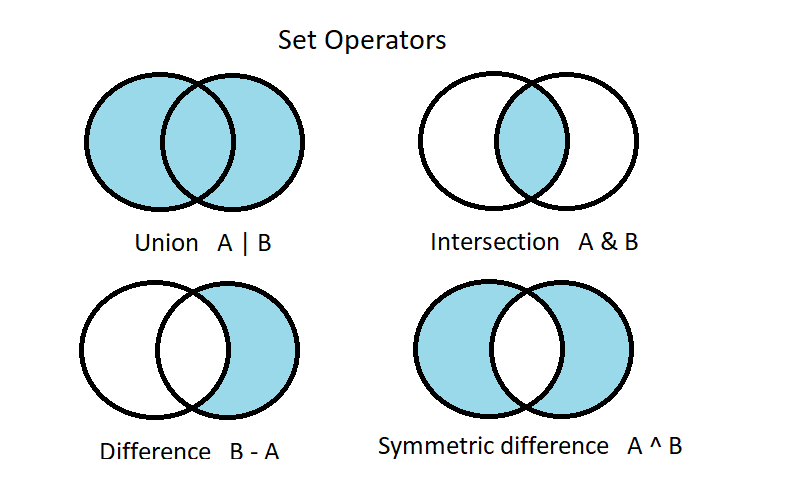

= Set Operators with Groovy&reg;
Paul King
:revdate: 2023-11-14T15:22:57+00:00
:keywords: groovy, emoji, set
:description: This blog looks at union, intersection, difference & symmetric difference operators in Groovy.

https://twitter.com/TheDonRaab[Donald Raab] posted https://donraab.medium.com/comparing-set-operations-between-java-and-eclipse-collections-92cf1df28d3b[an article] about set operators using Java collections and https://github.com/eclipse/eclipse-collections[Eclipse Collections]. https://donraab.medium.com/comparing-set-operations-between-java-and-eclipse-collections-92cf1df28d3b[That post] focuses
on the _union_, _intersection_ and _difference_ operators. We'll add in
_symmetric difference_ since Groovy supports operator overloading for that
operator also.

First, a quick refresh about the operators for two sets *A* and *B*:

We'll use the same emoji sets from Donald's post:

[source,groovy]
----
Set OCT = ["🍁", "🍃", "🎃", "🥧", "🍫", "🌝", "👻", "🌽", "🍎", "🪵", "☕️"]
Set NOV = ["🍂", "🍁", "🥧", "🦃", "🌽", "🍎", "🪵", "☕️"]
Set DEC = ["🥧", "🦃", "⛄️", "🍎", "🌰", "🛷", "🪵", "🎄", "☕️"]
----

Groovy lets you write the same code as in Donald's post but also offers
operator overloading for these operators as follows:

[source,groovy]
----
assert (OCT & NOV & DEC) == ["🪵", "🥧", "🍎", "☕️"] as Set

assert (OCT | NOV | DEC) == ["🪵", "🦃", "🌰", "🛷", "🍎", "🎄",
                             "🍫", "🌝", "☕️", "🥧", "⛄️", "🍁",
                             "🍂", "🍃", "👻", "🌽", "🎃"] as Set

assert (OCT - NOV - DEC) == ["🍫", "🌝", "🍃", "👻", "🎃"] as Set
assert (NOV - OCT - DEC) == ["🍂"] as Set
assert (DEC - OCT - NOV) == ["🎄", "🌰", "⛄️", "🛷"] as Set

assert (OCT ^ NOV ^ DEC) == ['⛄️', '🌰', '🛷', '🎄', '🍃', '🎃', '🍫', '🌝',
                             '👻', '🍂', '🥧', '🍎', '🪵', '☕️'] as Set
assert (NOV ^ OCT ^ DEC) == ['🍂', '🍃', '🎃', '🍫', '🌝', '👻', '🥧', '⛄️',
                             '🍎', '🌰', '🛷', '🪵', '🎄', '☕️'] as Set
----

This code is using standard mutable Java collections,
but we could use the normal `Set.of(...)` form and work with immutable sets
if that was our preference.

Also, since the Eclipse Collections Set implementations implement
the standard Java `Set` interface, these operator overloading shorthands
also work when using Eclipse Collections. We simply use
`Sets.immutable.of(...)` in our set definitions.

What's more, since Groovy operator overloading is extensible, you can have similar
shorthand notation for your own domain objects also. Enjoy!

This example used an alpha version of Groovy 5. Groovy 5 adds a little bit
of extra syntactic sugar when using sets. Earlier versions of Groovy
have `union` and `intersect` methods for sets.
