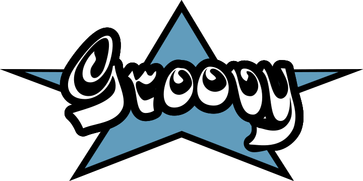
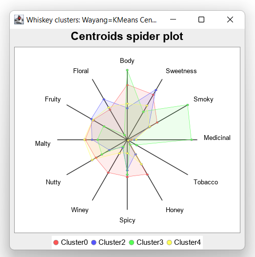

= Using Groovy&reg; with Apache Wayang and Apache Spark&trade;
Paul King <paulk-asert|PMC_Member>
:source-highlighter: pygments
:pygments-style: emacs
:icons: font
:revdate: 2022-06-19T13:01:07+00:00
:updated: 2025-08-25T14:11:00+00:00
:keywords: centroids, data science, groovy, kmeans, records, whisky, whiskey, wayang, apache spark, apache wayang
:description: This post looks at using Apache Wayang and Apache Spark with Apache Groovy to cluster various Whiskies.

> [blue]#_In the quest to find the perfect single-malt Scotch whisky,
> let's use Apache Wayang's cross-platform data processing and
> cross-platform machine learning capabilities to cluster
> related whiskies by their flavor profiles._#
>

image:https://www.apache.org/logos/res/wayang/default.png[wayang logo,100,float="right"]
https://wayang.apache.org/[Apache Wayang] (incubating) is an API
for big data cross-platform processing. It provides an abstraction
over other platforms like https://spark.apache.org/[Apache Spark]
and https://flink.apache.org/[Apache Flink] as well as a default
built-in stream-based "platform". The goal is to provide a
consistent developer experience when writing code regardless of
whether a light-weight or highly-scalable platform may eventually
be required. Execution of the application is specified in a logical
plan which is again platform agnostic. Wayang will transform the
logical plan into a set of physical operators to be executed by
specific underlying processing platforms.

== Whiskey Clustering

We'll take a look at using Apache Wayang with Groovy to help us in
the quest to find the perfect single-malt Scotch whiskey.
The whiskies produced from
https://www.niss.org/sites/default/files/ScotchWhisky01.txt[86 distilleries]
have been ranked by expert tasters according to 12 criteria
(Body, Sweetness, Malty, Smoky, Fruity, etc.).
We'll use a https://en.wikipedia.org/wiki/K-means_clustering[KMeans] algorithm to calculate the centroids.
This is similar to the
https://github.com/apache/incubator-wayang/blob/main/README.md#k-means[KMeans example in the Wayang documentation]
but instead of 2 dimensions (x and y coordinates), we have 12
dimensions corresponding to our criteria. The main point is that
it is illustrative of typical data science and machine learning
algorithms involving iteration (the typical map, filter, reduce
style of processing).

KMeans is a standard data-science clustering technique. In our
case, it groups whiskies with similar characteristics (according
to the 12 criteria) into clusters. If we have a favourite whiskey,
chances are we can find something similar by looking at other
instances in the same cluster. If we are feeling like a change,
we can look for a whiskey in some other cluster. The centroid
is the notional "point" in the middle of the cluster. For us,
it reflects the typical measure of each criteria for a whiskey
in that cluster.

== Implementing a distributed KMeans

We'll start by using Wayang's data processing capabilities
to write our own distributed KMeans algorithm.
This shows what is involved in writing a distributed
algorithm using Wayang if a pre-built version isn't available.
Later in this article,
we'll circle back to look at the new built-in KMeans
that is part of Wayang's ML4all module.

To build a distributed KMeans algorithm, we'll need to
pass around some information between the processing nodes
on whatever data processing platform (e.g. Apache Spark)
that we'll eventually use to run our application.
So, we first define those data structures.

We'll start with defining a Point record:

[source,groovy]
----
record Point(double[] pts) implements Serializable { }
----

We've made it `Serializable` (more on that later).
It's not a 2D or 3D point for us but 12D
corresponding to the 12 criteria. We just use a `double` array,
so any dimension would be supported but the 12 comes from the
number of columns in our data file.

We'll define a related `PointGrouping` record. It's like
`Point` but tracks an `int` cluster id and `long` count used
when clustering the points:

[source,groovy]
----
record PointGrouping(double[] pts, int cluster, long count) implements Serializable {
    PointGrouping(List<Double> pts, int cluster, long count) {
        this(pts as double[], cluster, count)
    }

    PointGrouping plus(PointGrouping that) {
        var newPts = pts.indices.collect{ pts[it] + that.pts[it] }
        new PointGrouping(newPts, cluster, count + that.count)
    }

    PointGrouping average() {
        new PointGrouping(pts.collect{ double d -> d/count }, cluster, 1)
    }
}
----

We have `plus` and `average` methods which will be helpful
later in the map/reduce parts of the algorithm.

Another aspect of the KMeans algorithm is assigning points to the
cluster associated with their nearest centroid. For 2 dimensions,
recalling pythagoras' theorem, this would be the square root of x
squared plus y squared, where x and y are the distance of a point
from the centroid in the x and y dimensions respectively. We'll do
the same across all dimensions and define the following helper
class to capture this part of the algorithm:

[source,groovy]
----
class SelectNearestCentroid implements ExtendedSerializableFunction<Point, PointGrouping> {
    Iterable<PointGrouping> centroids

    void open(ExecutionContext context) {
        centroids = context.getBroadcast('centroids')
    }

    PointGrouping apply(Point p) {
        var minDistance = Double.POSITIVE_INFINITY
        var nearestCentroidId = -1
        for (c in centroids) {
            var distance = sqrt(p.pts.indices
                .collect{ p.pts[it] - c.pts[it] }
                .sum{ it ** 2 } as double)
            if (distance < minDistance) {
                minDistance = distance
                nearestCentroidId = c.cluster
            }
        }
        new PointGrouping(p.pts, nearestCentroidId, 1)
    }
}
----

In Wayang parlance, the `SelectNearestCentroid` class is a
_UDF_, a User-Defined Function. It represents some chunk of
functionality where an optimization decision can be made about
where to run the operation.

To make our pipeline definitions a little shorter,
we'll define some useful operators in a `PipelineOps` helper class:

[source,groovy]
----
class PipelineOps {
    public static SerializableFunction<PointGrouping, Integer> cluster = tpc -> tpc.cluster
    public static SerializableFunction<PointGrouping, PointGrouping> average = tpc -> tpc.average()
    public static SerializableBinaryOperator<PointGrouping> plus = (tpc1, tpc2) -> tpc1 + tpc2
}
----

Now we are ready for our KMeans script:

[source,groovy]
----
int k = 5
int iterations = 10

// read in data from our file
var url = WhiskeyWayang.classLoader.getResource('whiskey.csv').file
def rows = new File(url).readLines()[1..-1]*.split(',')
var distilleries = rows*.getAt(1)
var pointsData = rows.collect{ new Point(it[2..-1] as double[]) }
var dims = pointsData[0].pts.size()

// create some random points as initial centroids
var r = new Random()
var randomPoint = { (0..<dims).collect { r.nextGaussian() + 2 } as double[] }
var initPts = (1..k).collect(randomPoint)

var context = new WayangContext()
    .withPlugin(Java.basicPlugin())
    .withPlugin(Spark.basicPlugin())
var planBuilder = new JavaPlanBuilder(context, "KMeans ($url, k=$k, iterations=$iterations)")

var points = planBuilder
    .loadCollection(pointsData).withName('Load points')

var initialCentroids = planBuilder
    .loadCollection((0..<k).collect{ idx -> new PointGrouping(initPts[idx], idx, 0) })
    .withName('Load random centroids')

var finalCentroids = initialCentroids.repeat(iterations, currentCentroids ->
    points.map(new SelectNearestCentroid())
        .withBroadcast(currentCentroids, 'centroids').withName('Find nearest centroid')
        .reduceByKey(cluster, plus).withName('Aggregate points')
        .map(average).withName('Average points')
        .withOutputClass(PointGrouping)
).withName('Loop').collect()

println 'Centroids:'
finalCentroids.each { c ->
    println "Cluster $c.cluster: ${c.pts.collect('%.2f'::formatted).join(', ')}"
}
----

Here, `k` is the desired number of clusters, and `iterations`
is the number of times to iterate through the KMeans loop.
The `pointsData` variable is a list of `Point` instances loaded
from our data file. We'd use the `readTextFile` method instead
of `loadCollection` if our data set was large.
The `initPts` variable is some random starting positions for our
initial centroids. Being random, and given the way the KMeans
algorithm works, it is possible that some of our clusters may
have no points assigned.Our algorithm works by assigning,
at each iteration, all the points to their closest current
centroid and then calculating the new centroids given those
assignments. Finally, we output the results.

Optionally, we might want to print out the distilleries allocated to each cluster.
The code looks like this:

[source,groovy]
----
var allocator = new SelectNearestCentroid(centroids: finalCentroids)
var allocations = pointsData.withIndex()
    .collect{ pt, idx -> [allocator.apply(pt).cluster, distilleries[idx]] }
    .groupBy{ cluster, ds -> "Cluster $cluster" }
    .collectValues{ v -> v.collect{ it[1] } }
    .sort{ it.key }
allocations.each{ c, ds -> println "$c (${ds.size()} members): ${ds.join(', ')}" }
----

== Running with the Java streams-backed platform

As we mentioned earlier, Wayang selects which platform(s) will
run our application. It has numerous capabilities whereby cost
functions and load estimators can be used to influence and
optimize how the application is run. For our simple example,
it is enough to know that even though we specified Java or
Spark as options, Wayang knows that for our small data set,
the Java streams option is the way to go.

Since we prime the algorithm with random data, we
expect the results to be slightly different each time
the script is run, but here is one output:

[source,shell]
----
> Task :WhiskeyWayang:run
Centroids:
Cluster 0: 2.53, 1.65, 2.76, 2.12, 0.29, 0.65, 1.65, 0.59, 1.35, 1.41, 1.35, 0.94
Cluster 2: 3.33, 2.56, 1.67, 0.11, 0.00, 1.89, 1.89, 2.78, 2.00, 1.89, 2.33, 1.33
Cluster 3: 1.42, 2.47, 1.03, 0.22, 0.06, 1.00, 1.03, 0.47, 1.19, 1.72, 1.92, 2.08
Cluster 4: 2.25, 2.38, 1.38, 0.08, 0.13, 1.79, 1.54, 1.33, 1.75, 2.17, 1.75, 1.79
...
----

Which, if plotted looks like this:

If you are interested, check out the examples in the repo links
at the end of this article to see the code for producing this
centroid spider plot or the Jupyter/BeakerX notebook in this
project's GitHub repo.

If printing out the cluster allocations, the output would be like this:

----
Cluster 0 (17 members): Ardbeg, Balblair, Bowmore, Bruichladdich, Caol Ila, Clynelish, GlenGarioch, GlenScotia, Highland Park, Isle of Jura, Lagavulin, Laphroig, Oban, OldPulteney, Springbank, Talisker, Teaninich
Cluster 2 (9 members): Aberlour, Balmenach, Dailuaine, Dalmore, Glendronach, Glenfarclas, Macallan, Mortlach, RoyalLochnagar
Cluster 3 (36 members): AnCnoc, ArranIsleOf, Auchentoshan, Aultmore, Benriach, Bladnoch, Bunnahabhain, Cardhu, Craigganmore, Dalwhinnie, Dufftown, GlenElgin, GlenGrant, GlenMoray, GlenSpey, Glenallachie, Glenfiddich, Glengoyne, Glenkinchie, Glenlossie, Glenmorangie, Inchgower, Linkwood, Loch Lomond, Mannochmore, Miltonduff, RoyalBrackla, Speyburn, Speyside, Strathmill, Tamdhu, Tamnavulin, Tobermory, Tomintoul, Tomore, Tullibardine
Cluster 4 (24 members): Aberfeldy, Ardmore, Auchroisk, Belvenie, BenNevis, Benrinnes, Benromach, BlairAthol, Craigallechie, Deanston, Edradour, GlenDeveronMacduff, GlenKeith, GlenOrd, Glendullan, Glenlivet, Glenrothes, Glenturret, Knochando, Longmorn, OldFettercairn, Scapa, Strathisla, Tomatin
----

== Running with Apache Spark

image:https://www.apache.org/logos/res/spark/default.png[spark logo,100,float="right"]
Given our small dataset size and no other customization, Wayang
will choose the Java streams based solution. We could use Wayang
optimization features to influence which processing platform it
chooses, but to keep things simple, we'll just disable the Java
streams platform in our configuration by making the following
change in our code:

[source,groovy,highlight=4]
----
...
var context = new WayangContext()
//    .withPlugin(Java.basicPlugin())     <1>
    .withPlugin(Spark.basicPlugin())
...
----
<1> Disabled

Now when we run the application, the output will be something like
this (a solution similar to before but with 1000+ extra lines of
Spark and Wayang log information - truncated for presentation purposes):

----
[main] INFO org.apache.spark.SparkContext - Running Spark version 3.5.6
...
[dag-scheduler-event-loop] INFO org.apache.spark.scheduler.DAGScheduler - Got job 0 (foreachPartition at SparkCacheOperator.java:62) with 4 output partitions
...
[dag-scheduler-event-loop] INFO org.apache.spark.scheduler.DAGScheduler - Job 14 is finished.
...
Centroids:
Cluster 4: 1.63, 2.26, 1.68, 0.63, 0.16, 1.47, 1.42, 0.89, 1.16, 1.95, 0.89, 1.58
Cluster 0: 2.76, 2.44, 1.44, 0.04, 0.00, 1.88, 1.68, 1.92, 1.92, 2.04, 2.16, 1.72
Cluster 1: 3.11, 1.44, 3.11, 2.89, 0.56, 0.22, 1.56, 0.44, 1.44, 1.44, 1.33, 0.44
Cluster 2: 1.52, 2.42, 1.09, 0.24, 0.06, 0.91, 1.09, 0.45, 1.30, 1.64, 2.18, 2.09
...
[shutdown-hook-0] INFO org.apache.spark.SparkContext - Successfully stopped SparkContext
----

== Using ML4all

In recent versions of Wayang, a new abstraction, called ML4all has been introduced.
It frees users from the burden of machine learning algorithm selection and low-level implementation details. Many readers will be familiar with how systems supporting
_MapReduce_ split functionality into `map`, `filter` or `shuffle`, and `reduce` steps.
ML4all abstracts machine learning algorithm functionality into 7 operators:
`Transform`, `Stage`, `Compute`, `Update`, `Sample`, `Converge`, and `Loop`.

Wayang comes bundled with implementations for many of these operators, but
you can write your own like we have here for the Transform operator:

[source,groovy]
----
class TransformCSV extends Transform<double[], String> {
    double[] transform(String input) {
        input.split(',')[2..-1] as double[]
    }
}
----

ML4all includes a pre-defined `KMeansStageWithZeros` localStage operator, but
we'll initialize our KMeans using random centroids with a custom operator:

[source,groovy]
----
class KMeansStageWithRandoms extends LocalStage {
    int k, dimension
    private r = new Random()

    void staging(ML4allModel model) {
        double[][] centers = new double[k][]
        for (i in 0..<k) {
            centers[i] = (0..<dimension).collect { r.nextGaussian() + 2 } as double[]
        }
        model.put('centers', centers)
    }
}
----

With these operators defined, we can now write our scripts:

[source,groovy]
----
var dims = 12
var context = new WayangContext()
    .withPlugin(Spark.basicPlugin())
    .withPlugin(Java.basicPlugin())

var plan = new ML4allPlan(
    transformOp: new TransformCSV(),
    localStage: new KMeansStageWithRandoms(k: k, dimension: dims),
    computeOp: new KMeansCompute(),
    updateOp: new KMeansUpdate(),
    loopOp: new KMeansConvergeOrMaxIterationsLoop(accuracy, maxIterations)
)

var model = plan.execute('file:' + url, context)
model.getByKey("centers").eachWithIndex { center, idx ->
    var pts = center.collect('%.2f'::formatted).join(', ')
    println "Cluster$idx: $pts"
}
----

When run we get this output:

----
Cluster0: 1.57, 2.32, 1.32, 0.45, 0.09, 1.08, 1.19, 0.60, 1.26, 1.74, 1.72, 1.85
Cluster1: 3.43, 1.57, 3.43, 3.14, 0.57, 0.14, 1.71, 0.43, 1.29, 1.43, 1.29, 0.14
Cluster2: 2.73, 2.42, 1.46, 0.04, 0.04, 1.88, 1.69, 1.88, 1.92, 2.04, 2.12, 1.81
----

== Discussion

A goal of Apache Wayang is to allow developers to write
platform-agnostic applications. While this is mostly true,
the abstractions aren't perfect. As an example, if I know I
am only using the streams-backed platform, I don't need to worry
about making any of my classes serializable (which is a Spark
requirement). In our example, we could have omitted the
`implements Serializable` part of the `PointGrouping` record,
and several of our pipeline operators may have reduced to simple closures.
This isn't meant to be a criticism of Wayang,
after all if you want to write cross-platform UDFs, you might
expect to have to follow some rules. Instead, it is meant to
just indicate that abstractions often have leaks around the edges.
Sometimes those leaks can be beneficially used, other times they
are traps waiting for unknowing developers.

We ran this example using JDK17, but on earlier
JDK versions, Groovy will use emulated records
instead of native records without changing the source code.

== Conclusion

We have looked at using Apache Wayang to implement a KMeans
algorithm that runs either backed by the JDK streams capabilities
or by Apache Spark. The Wayang API hid from us some of the
complexities of writing code that works on a distributed platform
and some of the intricacies of dealing with the Spark platform.
The abstractions aren't perfect, but they certainly aren't hard to
use and provide extra protection should we wish to move between
platforms. As an added bonus, they open up numerous optimization
possibilities.

Apache Wayang is an incubating project at Apache and still has
work to do before it graduates but lots of work has gone on
previously (it was previously known as Rheem and was started
in 2015). Platform-agnostic applications is a holy grail that
has been desired for many years but is hard to achieve.
It should be exciting to see how far Apache Wayang progresses
in achieving this goal.

== More Information

* Repo containing the source code: https://github.com/paulk-asert/groovy-data-science/tree/master/subprojects/WhiskeyWayang[WhiskeyWayang]
* Repo containing solutions to this problem using a variety of non-distributed libraries including Apache Commons CSV, Weka, Smile, Tribuo and others:
https://github.com/paulk-asert/groovy-data-science/tree/master/subprojects/Whiskey[Whiskey]
* A similar example using https://spark.apache.org/[Apache Spark] directly but with a built-in parallelized KMeans from the `spark-mllib` library:
https://github.com/paulk-asert/groovy-data-science/tree/master/subprojects/WhiskeySpark[WhiskeySpark]
* A similar example using https://ignite.apache.org/[Apache Ignite] using the built-in clustered KMeans from the `ignite-ml` library:
https://github.com/paulk-asert/groovy-data-science/tree/master/subprojects/WhiskeyIgnite[WhiskeyIgnite]
* A similar example using https://flink.apache.org/[Apache Flink] using KMeans from the Flink ML (`flink-ml-uber`) library:
https://github.com/paulk-asert/groovy-data-science/tree/master/subprojects/WhiskeyFlink[WhiskeyFlink]

.Update history
****
*19/Jun/2022*: Initial version. +
*20/Feb/2025*: Updated for Apache Wayang 1.0.0. +
*25/Aug/2025*: Updated for Apache Wayang 1.1.0 and Groovy 5.0.0.
****

